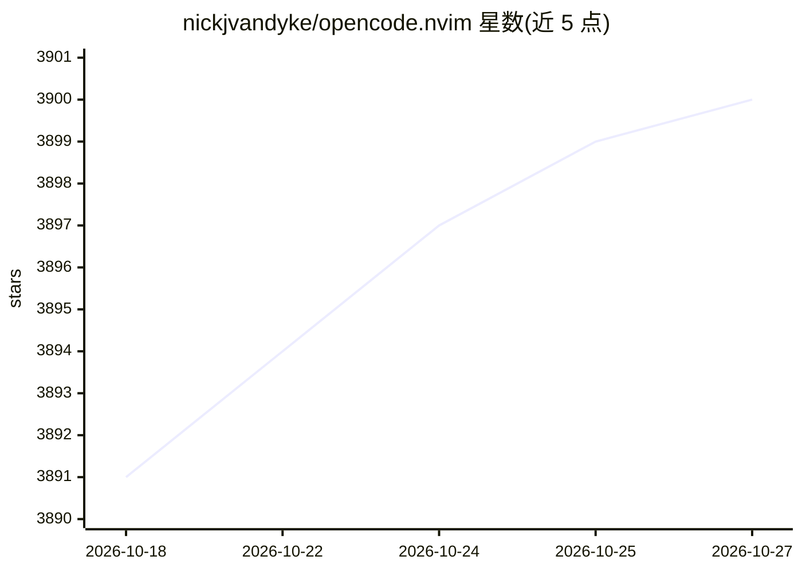

# nickjvandyke/opencode.nvim

⭐ 3,900 · Lua · MIT · 推送 2026-10-24 · [GitHub](https://github.com/nickjvandyke/opencode.nvim) · 个人维护

**在 Neovim 中接入 OpenCode AI 编程助手的插件**

Neovim 插件，通过 OpenCode 的 TUI 与 API 将其接入编辑器：自动发现或启动 OpenCode daemon 服务，注入光标、选区、buffer、诊断、quickfix 等编辑器上下文，提供内置提示词（解释/修复/评审/测试等）、命令执行、SSE 事件转发为 autocmd、实时重载 AI 编辑并以 :diffpatch 侧边展示待批准的改动与权限请求。安装支持 vim.pack、lazy.nvim、nixvim，并可与 snacks、blink.cmp、lualine 集成。面向使用 Neovim 并希望以 Vim 风格交互使用 OpenCode 的开发者。

## 筛选速览

| 维度 | 判定 | 备注 |
|---|---|---|
| AI 角色 | `ai-ecosystem` | LLM/agent 周边工具 |
| 许可风险 | `permissive` | MIT |
| 部署形态 | `None` |  |
| 模型依赖 | — | README 未给出锁定关系 |
| 硬件要求 | — | 无带数字的原话,不猜 |
| 安装摩擦 | `low` | 无编译、无系统依赖或容器化 |
| 成熟度 | — | 结构信号不足 |

## 能力要点

- 自动发现或启动 OpenCode 服务并转发其 SSE 事件为 autocmd
- 注入光标/选区/buffer/诊断/quickfix 等编辑器上下文（占位符机制）
- OpenCode 的文件编辑以 :diffpatch 侧边呈现，支持按 hunk 接受或拒绝
- 提供 vim.pack / lazy.nvim / nixvim 安装方式与 snacks、blink.cmp、lualine 集成

## 适用场景

- 在 Neovim 内直接向 OpenCode 提问并注入当前代码上下文
- 以 diff 视图审查并逐块接受 AI 的代码编辑
- 用内置或自定义提示词执行解释、修复、评审、加测试等操作

## 场景标签

`编码 Agent` · 领域:编码与开发

## 证据(README 行号)

> L3: Neovim plugin that integrates with OpenCode to keep you in the flow that you already know.
> L11: Rather than introduce yet another interaction model, opencode.nvim leverages OpenCode's existing TUI and API via st

## 星数曲线

2026-10-18 3,891 → 2026-10-27 3,900（+9）

---
*卡片 v1 · prompt 1.4 · 生成 2026-10-20 · 置信度 high · 依据 README sha `7aaab8034b27` · [字段定义](../../DATASET.md)*
