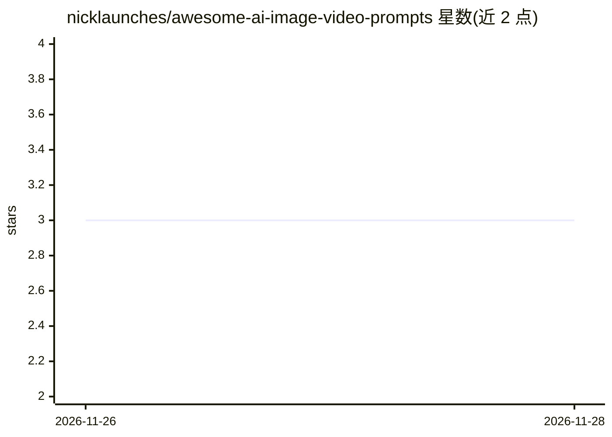

# nicklaunches/awesome-ai-image-video-prompts

⭐ 3 · Python · NOASSERTION · 推送 2026-11-22 · [GitHub](https://github.com/nicklaunches/awesome-ai-image-video-prompts) · [官网](https://trypromptgenerator.com/prompts) · 个人维护

**面向 AI 图像/视频用户：571 条实测提示词及效果预览**

一份 awesome 类提示词清单：收录 571 条在 31 个模型上实测的图像与视频提示词（405 条图像、166 条视频），涵盖 Nano Banana Pro、FLUX.2、Qwen Image、Seedance 2.0、Veo 3.1 等。每条目提供可复制提示词、生成结果预览，条目页含提示词结构解析与变体。使用方式为复制提示词后粘贴到对应模型使用；README 未提供安装或运行说明，纯内容清单。

## 筛选速览

| 维度 | 判定 | 备注 |
|---|---|---|
| AI 角色 | `ai-knowledge` | 知识聚合/清单类 |
| 许可风险 | `none` | NOASSERTION |
| 部署形态 | `None` |  |
| 模型依赖 | — | README 未给出锁定关系 |
| 硬件要求 | — | 无带数字的原话,不猜 |
| 安装摩擦 | `low` | 无编译、无系统依赖或容器化 |
| 成熟度 | — | 结构信号不足 |

## 能力要点

- 571 条实测提示词，每条附生成结果预览
- 覆盖 31 个模型，含图像（405）与视频（166）两类
- 条目页提供提示词各部分作用解析与变体建议
- 代码块一键复制

## 适用场景

- 为 Gemini 照片编辑寻找可用的人物场景提示词
- 查找产品照、节日肖像类图像提示词
- 参考 FLUX/Qwen/Seedance 等模型的图像风格提示词写法

## 场景标签

`精选清单` · 领域:学习与行业

## 证据(README 行号)

> L3: 571 tested AI image and video prompts across 31 models, including Nano Banana Pro (the model behind Gemini AI photo 
> L5: The prompts come from the Prompt Generator prompt library. Every entry has a copy button on its code block and a lin

## 星数曲线

2026-11-26 3 → 2026-11-28 3（+0）

---
*卡片 v1 · prompt 1.4 · 生成 2026-11-26 · 置信度 high · 依据 README sha `a4121a624f48` · [字段定义](../../DATASET.md)*
