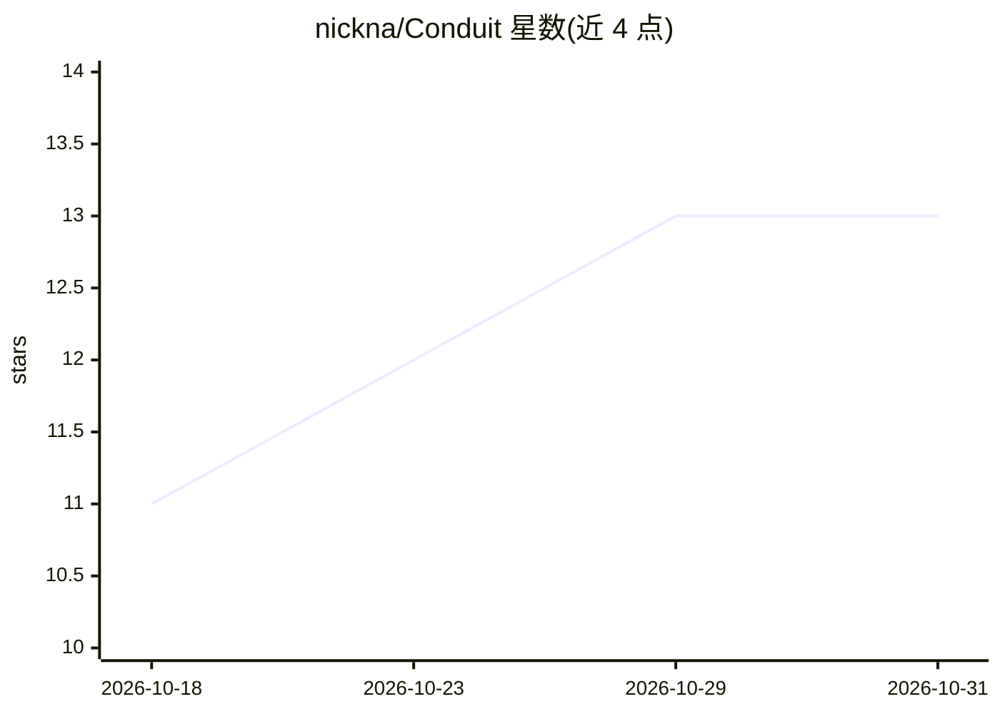

# nickna/Conduit

⭐ 13 · C# · MIT · 推送 2026-10-30 · [GitHub](https://github.com/nickna/Conduit) · 个人维护

**多 LLM 供应商统一网关：OpenAI 兼容 API 与计费路由**

ConduitLLM 是用 .NET 构建的 LLM 网关：以一套 OpenAI 兼容 REST API 对接多个上游供应商，客户端用虚拟密钥（condt_...）认证，经模型别名路由到具体供应商与账号，支持多账号负载分摊与自动故障切换。内置预付费计费、预算与花费追踪、逐请求计费对账，支持聊天、嵌入、图像/视频生成、语音及流式 SSE、服务端函数调用。含 Next.js 管理 UI、Prometheus/Grafana 可观测栈，需 PostgreSQL 与 Redis，经 Docker Compose 部署。

## 筛选速览

| 维度 | 判定 | 备注 |
|---|---|---|
| AI 角色 | `ai-ecosystem` | LLM/agent 周边工具 |
| 许可风险 | `permissive` | MIT |
| 部署形态 | `self-host` | docker 或自建部署 |
| 模型依赖 | — | README 未给出锁定关系 |
| 硬件要求 | — | 无带数字的原话,不猜 |
| 安装摩擦 | `low` | 无编译、无系统依赖或容器化 |
| 成熟度 | — | 结构信号不足 |

## 能力要点

- OpenAI 兼容 API，标准 OpenAI SDK 可直连
- 虚拟密钥体系：预算、预付费余额与逐请求计费对账
- 模型别名路由：会话亲和、故障切换与 kill switch
- 多模态支持：聊天/嵌入/图像/视频/语音与 SSE 流式

## 适用场景

- 统一接入多个 LLM 供应商，避免供应商锁定
- 为应用发放带花费限额的虚拟 API 密钥
- 集中监控 LLM 调用成本与上游健康状态

## 场景标签

`模型网关` · 领域:Agent 开发

## 证据(README 行号)

> L9: > An LLM gateway: one OpenAI-compatible API in front of many upstream providers, with central
> L26: A client authenticates with a **virtual key**, sends a request naming a **model alias**, and

## 星数曲线

2026-10-18 11 → 2026-10-31 13（+2）

---
*卡片 v1 · prompt 1.4 · 生成 2026-10-31 · 置信度 high · 依据 README sha `a86e62df8025` · [字段定义](../../DATASET.md)*
