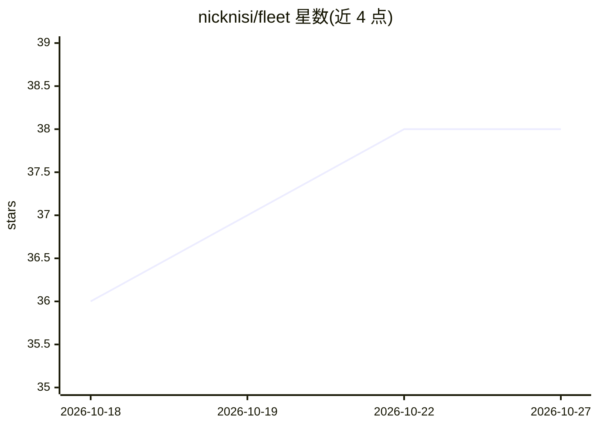

# nicknisi/fleet

⭐ 38 · TypeScript · MIT · 推送 2026-10-16 · [GitHub](https://github.com/nicknisi/fleet) · 个人维护

**tmux 终端面板：集中管理多个 AI agent 会话并批量发送提示**

面向开发者的终端 TUI 仪表盘，用于在 tmux 中管理多个 AI agent 会话。通过 Claude Code 插件钩子实时追踪 agent 状态，按紧急度排序展示等待审批/提问/就绪/工作中等七种状态，也支持 Codex 与 pi 的钩子接入，并可通过进程表发现无集成的 agent（如 aider、opencode）。支持发送提示、权限审批、passthrough 直通输入、会话预览与状态溯源覆盖层。以 Bun 编译的二进制分发，Homebrew 或源码构建安装，需 tmux 环境。

## 筛选速览

| 维度 | 判定 | 备注 |
|---|---|---|
| AI 角色 | `ai-ecosystem` | LLM/agent 周边工具 |
| 许可风险 | `permissive` | MIT |
| 部署形态 | `None` |  |
| 模型依赖 | — | README 未给出锁定关系 |
| 硬件要求 | — | 无带数字的原话,不猜 |
| 安装摩擦 | `low` | 无编译、无系统依赖或容器化 |
| 成熟度 | — | 结构信号不足 |

## 能力要点

- 七种 agent 状态按紧急度排序，实时汇总条显示整体状态
- 钩子接入 Claude Code/Codex/pi，进程表发现无集成 agent（aider、opencode 等）
- 发送/终止会话带状态门控：拒绝误批权限、误答问题或误杀工作中的 agent
- 状态溯源覆盖层展示状态判定来源与决策细节

## 适用场景

- 并行运行多个编码 agent 时在一处看到谁需要我
- 从单一面板给指定 agent 发送提示并审批权限
- 预览与直通模式查看/干预某个 agent 的终端输出

## 场景标签

`编码 Agent` · 领域:编码与开发

## 证据(README 行号)

> L3: A terminal dashboard for managing multiple AI agent sessions in tmux.
> L5: Fleet watches your Claude Code sessions, shows which agents need attention, and lets you send prompts — all from a s
> L100: The dashboard shows every Claude Code pane grouped by urgency. Agents that need you sort to the top. Plain shell p

## 星数曲线

2026-10-18 36 → 2026-10-27 38（+2）

---
*卡片 v1 · prompt 1.4 · 生成 2026-10-25 · 置信度 high · 依据 README sha `0c1481fcf527` · [字段定义](../../DATASET.md)*
