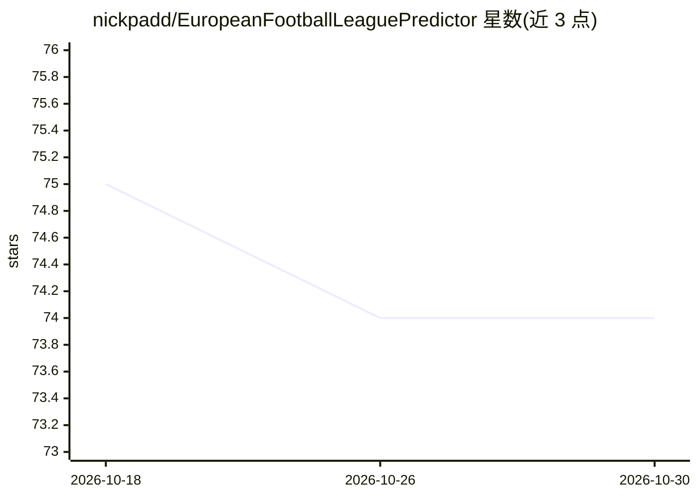

# nickpadd/EuropeanFootballLeaguePredictor

⭐ 74 · Python · MIT · 推送 2026-02-17 · [GitHub](https://github.com/nickpadd/EuropeanFootballLeaguePredictor) · [官网](https://nickpadd.github.io/EuropeanFootballLeaguePredictor/Home.html) · 个人维护

**欧洲五大联赛足球比赛结果预测的机器学习/统计模型**

基于球队历史表现与联赛统计数据的足球比赛预测工具，覆盖英超、西甲、法甲、德甲、意甲。使用传统机器学习（LinearRegression/PoissonRegressor/SVR）结合长短期状态加权投票生成预测概率，含数据收集、预测（脚本或本地 Web 应用）、按赛季留一法评估（ROI 指标，经 mlflow 记录）与 Kelly 准则投注模拟。项目已声明不再积极维护，仅供教育与研究用途。通过 shell/bat 脚本安装依赖并创建虚拟环境运行。

## 筛选速览

| 维度 | 判定 | 备注 |
|---|---|---|
| AI 角色 | `ai-native` | 本体是模型或模型工具 |
| 许可风险 | `permissive` | MIT |
| 部署形态 | `None` |  |
| 模型依赖 | — | README 未给出锁定关系 |
| 硬件要求 | — | 无带数字的原话,不猜 |
| 安装摩擦 | `low` | 无编译、无系统依赖或容器化 |
| 成熟度 | — | 结构信号不足 |

## 能力要点

- 支持英超/西甲/法甲/德甲/意甲五大联赛
- LinearRegression/PoissonRegressor/SVR 三种回归器可选，长短状态加权投票
- 预测可经本地 Web 应用或脚本输出（交互图与 HTML 表格）
- 留一赛季评估并输出各投注类别的 ROI 指标，经 mlflow 记录

## 适用场景

- 跑一遍数据收集→预测→评估的完整流程，研究生联赛预测模型
- 用历史赛季回测不同回归器与参数组合的 ROI 表现
- 生成本周欧洲联赛比赛的预测概率（仅供研究参考）

## 场景标签

`金融量化` · 领域:学习与行业

## 证据(README 行号)

> L3: EuropeanFootballLeaguePredictor is a predictor of europes top league games based on historic performances of teams, 

## 星数曲线

2026-10-18 75 → 2026-10-30 74（-1）

---
*卡片 v1 · prompt 1.4 · 生成 2026-10-24 · 置信度 high · 依据 README sha `fa793c887a63` · [字段定义](../../DATASET.md)*
