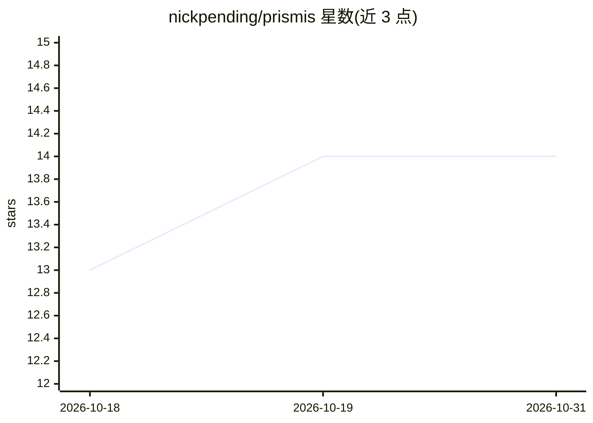

# nickpending/prismis

⭐ 14 · Python · MIT · 推送 2026-10-29 · [GitHub](https://github.com/nickpending/prismis) · [官网](https://prismis.io) · 个人维护

**本地优先的内容智能守护进程：AI 给 RSS/Reddit/YouTube 信息流评分**

以守护进程方式抓取 RSS、subreddit、YouTube 频道、Hacker News 等来源，将条目全文交由配置的 LLM（默认 OpenRouter，或任意 OpenAI 兼容端点含本地服务）按用户 context.md 生成摘要并评 HIGH/MEDIUM/LOW；HIGH 条目可做二次深度合成，👍/👎 投票反馈评分。数据存本机 SQLite。消费端提供 TUI、Web 每日简报、macOS 菜单栏应用和面向脚本/agent 的 CLI（--json）。macOS 经 Homebrew 安装，Linux 从源码构建（需 Go 1.26+、Python 3.14+、uv）；自述为 Alpha 状态。

## 筛选速览

| 维度 | 判定 | 备注 |
|---|---|---|
| AI 角色 | `ai-native` | 本体是模型或模型工具 |
| 许可风险 | `permissive` | MIT |
| 部署形态 | `None` |  |
| 模型依赖 | locked-api |  |
| 硬件要求 | — | 无带数字的原话,不猜 |
| 安装摩擦 | `medium` | 含编译或系统依赖之一 |
| 成熟度 | `idea` | |

## 能力要点

- LLM 摘要 + 按个人 context.md 的高/中/低优先级评分
- 👍/👎 投票反馈影响后续评分
- 四种消费端：TUI、Web 简报、macOS 菜单栏、CLI（--json 供 agent 使用）
- 数据本地 SQLite 存储，支持任意 OpenAI 兼容端点（含本地）

## 适用场景

- 用自然语言描述关注点，让 AI 筛选海量信息流只留重点
- 在终端或手机上阅读每日 AI 简报与深度合成分析
- 通过 CLI --json 把阅读队列接入脚本或其他 agent

## 场景标签

`网页抓取` `AI 助手` · 领域:效率与自动化

## 证据(README 行号)

> L33: News), and asks an LLM to summarize each one and rate it HIGH, MEDIUM or LOW against your
> L39: configure (OpenRouter by default, or any OpenAI-compatible endpoint, including a local one).

## 星数曲线

2026-10-18 13 → 2026-10-31 14（+1）

---
*卡片 v1 · prompt 1.4 · 生成 2026-10-31 · 置信度 high · 依据 README sha `9503b140a18c` · [字段定义](../../DATASET.md)*
