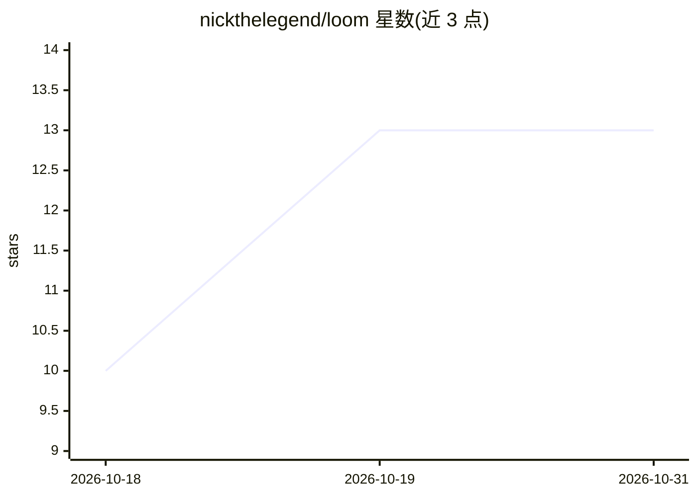

# nickthelegend/loom

⭐ 13 · TypeScript · MIT · 推送 2026-10-25 · [GitHub](https://github.com/nickthelegend/loom) · 个人维护

**本地优先的编码 agent 控制面：多 CLI 共享记忆与接力协作**

Loom 是一个 TypeScript 编写的本地优先 CLI/应用，作为多个编码 agent（Claude Code、Codex、OpenCode、Grok Code、Antigravity 等）之间的共享记忆层与控制面：把各 ADE 的本地记忆（CLAUDE.md、AGENTS.md 等）导入统一共享存储，支持 agent 间接力（baton handoff）、配额触发的自动转交（Quota Relay）、对 agent 测试声明的三重核验（Proof）、带角色的 Crews 团队与任务图并行编排（Orchestra），并以 OpenTelemetry 导出全部轨迹供 Observatory 查看。另支持任意 OpenAI 兼容端点作为 model agent。面向使用多个编码 agent 的开发者。

## 筛选速览

| 维度 | 判定 | 备注 |
|---|---|---|
| AI 角色 | `ai-ecosystem` | LLM/agent 周边工具 |
| 许可风险 | `permissive` | MIT |
| 部署形态 | `desktop` | 安装包/桌面程序 |
| 模型依赖 | local-ok | 支持本地模型 |
| 硬件要求 | — | 无带数字的原话,不猜 |
| 安装摩擦 | `low` | 无编译、无系统依赖或容器化 |
| 成熟度 | — | 结构信号不足 |

## 能力要点

- 统一共享记忆：导入各 ADE 原生记忆文件并回写统一存储
- Quota Relay：agent 触发用量上限时自动转交接力并排队/归还
- Proof：对 agent '测试通过' 声明做三轮核验（声明/实际命令/干净重跑）
- Orchestra：任一 agent 作编排者，按任务图在独立 worktree 并行执行并合并

## 适用场景

- 在 Claude Code、Codex、OpenCode 等多个 CLI agent 之间共享上下文并接力任务
- agent 撞上配额限制时自动切换到空闲 agent 继续工作
- 核验 agent 声称 '测试全过' 是否属实
- 以一个 agent 编排多个 worker agent 并行完成同一目标

## 场景标签

`多智能体` `Agent 记忆` · 领域:Agent 开发

## 证据(README 行号)

> L7: **The shared-memory layer for AI dev environments.** Every coding agent — Claude Code,
> L31: Loom is **not** another IDE. It's the thin layer *between* your agents — the continuity
> L159: agent: Claude Code, Codex (ChatGPT), Antigravity, Grok or OpenCode.

## 星数曲线

2026-10-18 10 → 2026-10-31 13（+3）

---
*卡片 v1 · prompt 1.4 · 生成 2026-10-31 · 置信度 high · 依据 README sha `7991c22fc840` · [字段定义](../../DATASET.md)*
