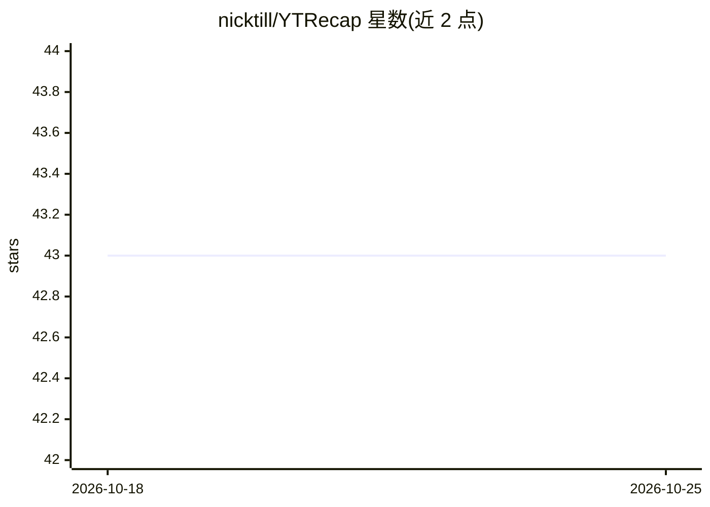

# nicktill/YTRecap

⭐ 43 · CSS · MIT · 推送 2026-09-30 · [GitHub](https://github.com/nicktill/YTRecap) · [官网](https://ytrecap.org/) · 个人维护

**将 YouTube 视频字幕生成 AI 摘要与章节的 Flask 应用**

Flask Web 应用：用 youtube-transcript-api 抓取视频字幕，调用 OpenAI 兼容提供商（Gemini 备用）生成流式摘要、要点与可点击时间戳章节；支持简短/标准/详细三种摘要、明暗主题与 Markdown 下载。字幕不可得时退化为仅描述模式并明确标注，无可用描述则报告无法总结。无 AI key 时以演示模式运行示例摘要。本地通过 git clone 与 venv 运行，可部署到 Vercel。

## 筛选速览

| 维度 | 判定 | 备注 |
|---|---|---|
| AI 角色 | `ai-native` | 本体是模型或模型工具 |
| 许可风险 | `permissive` | MIT |
| 部署形态 | `None` |  |
| 模型依赖 | — | README 未给出锁定关系 |
| 硬件要求 | — | 无带数字的原话,不猜 |
| 安装摩擦 | `low` | 无编译、无系统依赖或容器化 |
| 成熟度 | — | 结构信号不足 |

## 能力要点

- 字幕→流式 AI 摘要、要点与可点击时间戳章节
- OpenAI 兼容提供商优先、Gemini 备用，均带短超时
- 无字幕时退化为标注的仅描述结果；无 key 时运行演示模式
- 支持 YT_PROXY_URL 住宅代理抓取字幕与字幕缓存

## 适用场景

- 快速获取 YouTube 视频的摘要与要点
- 通过章节时间戳跳转到视频关键部分
- 下载 Markdown 格式的视频摘要

## 场景标签

`AI 写作` · 领域:内容生成

## 证据(README 行号)

> L3: YTRecap turns YouTube captions into AI summaries, key takeaways, and clickable chapters. The Flask app streams resul
> L5: Captions are fetched with `youtube-transcript-api`, optionally through a residential proxy configured with `YT_PROXY

## 星数曲线

2026-10-18 43 → 2026-10-25 43（+0）

---
*卡片 v1 · prompt 1.4 · 生成 2026-10-25 · 置信度 high · 依据 README sha `eb8b98150e90` · [字段定义](../../DATASET.md)*
