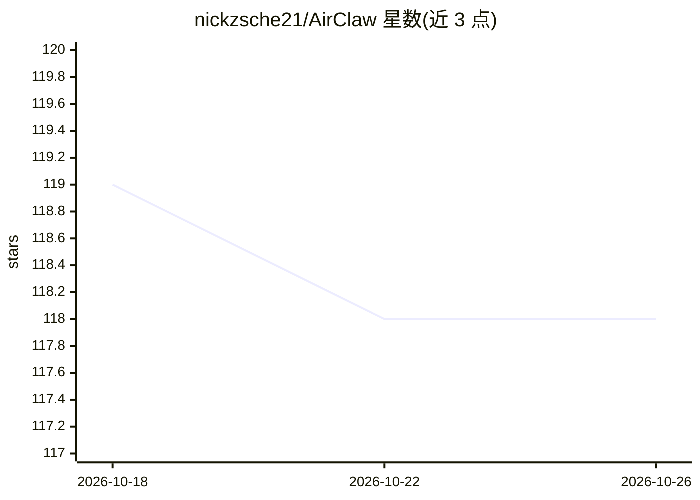

# nickzsche21/AirClaw

⭐ 118 · Python · MIT · 推送 2026-08-31 · [GitHub](https://github.com/nickzsche21/AirClaw) · [官网](https://pypi.org/project/airclaw/) · 个人维护

**让 OpenClaw agent 跑在本地模型上的 OpenAI 兼容网关**

面向 OpenClaw 用户的本地推理网关：在本地推理服务（Ollama、LM Studio、llama.cpp、vLLM、Jan、text-generation-webui）之前放置一个稳定端口 :4096 的 OpenAI 兼容端点，自动探测后端并写入 OpenClaw 配置；更换后端无需改 agent 配置。转发流式、工具调用与采样参数，不截断提示词。另有 AirLLM 模式可运行超出显存的模型但速度极慢且不支持工具调用。以 pip 从 git 安装，PyPI 上 2.x 版本已知损坏。

## 筛选速览

| 维度 | 判定 | 备注 |
|---|---|---|
| AI 角色 | `ai-ecosystem` | LLM/agent 周边工具 |
| 许可风险 | `permissive` | MIT |
| 部署形态 | `library` | 以包/库形式分发 |
| 模型依赖 | local-ok | 支持本地模型 |
| 硬件要求 | — | 无带数字的原话,不猜 |
| 安装摩擦 | `low` | 无编译、无系统依赖或容器化 |
| 成熟度 | `idea` | |

## 能力要点

- 自动探测 Ollama/LM Studio/llama.cpp/vLLM 等本地后端并生成稳定 OpenAI 兼容端点
- airclaw patch 自动写入并备份 OpenClaw 配置，restore 可回滚
- AirLLM 模式可将 70B 模型装入约 4GB 显存（秒级每 token，无工具调用）
- airclaw doctor 诊断整条链路故障

## 适用场景

- 让 OpenClaw agent 使用本地模型运行，避免 API 费用
- 在不修改 agent 配置的情况下切换本地推理后端
- 用小显存机器通过 AirLLM 跑超大参数模型

## 场景标签

`模型网关` · 领域:Agent 开发

## 证据(README 行号)

> L5: AirClaw puts one stable OpenAI-compatible endpoint in front of whatever local
> L71: OpenClaw ──> AirClaw gateway :4096 ──> Ollama / llama.cpp / vLLM / LM Studio

## 星数曲线

2026-10-18 119 → 2026-10-26 118（-1）

---
*卡片 v1 · prompt 1.4 · 生成 2026-10-23 · 置信度 high · 依据 README sha `565c45234a8d` · [字段定义](../../DATASET.md)*
