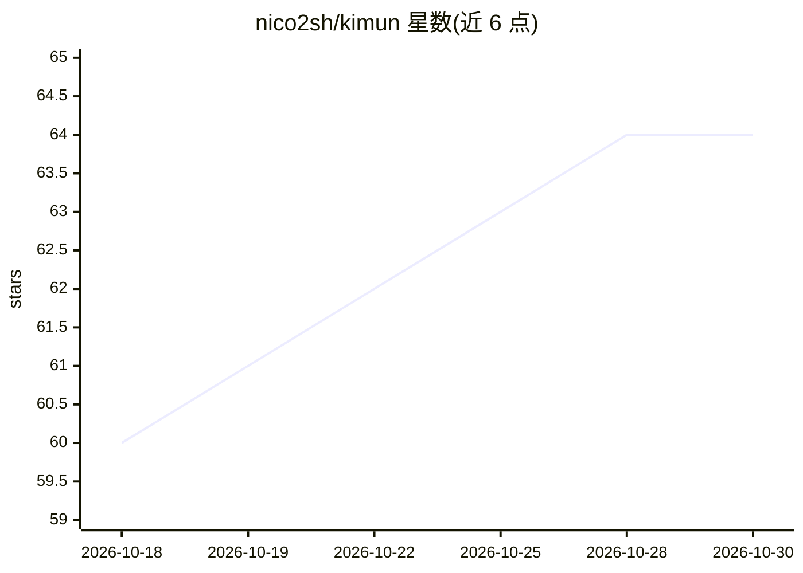

# nico2sh/kimun

⭐ 64 · Rust · MIT · 推送 2026-10-20 · [GitHub](https://github.com/nico2sh/kimun) · [官网](https://nico2sh.github.io/kimun/) · 个人维护

**本地优先的终端 Markdown 笔记应用，带 MCP 与可选 RAG 服务**

用 Rust 编写的终端（TUI/CLI）笔记应用：笔记以本地 Markdown 文件存储并索引到 SQLite，提供全文、结构化与模糊搜索，支持 [[wikilinks]]、反向链接、多工作区与 Vim 操作。AI 为可选组件：内置 MCP Server 供 Claude Code 等 agent 读取/更新/检索笔记；配套 kimun-server 提供语义搜索与基于自有笔记的 RAG 问答（本地嵌入 + 可选本地或云端 LLM）。安装方式含脚本、Homebrew、Cargo 与 Docker（服务端）。README 自述处于重度开发期，配置与主题可能随更新失效。

## 筛选速览

| 维度 | 判定 | 备注 |
|---|---|---|
| AI 角色 | `ai-enhanced` | 去掉 AI 部分产品仍成立 |
| 许可风险 | `permissive` | MIT |
| 部署形态 | `library` | 以包/库形式分发 |
| 模型依赖 | locked-api |  |
| 硬件要求 | — | 无带数字的原话,不猜 |
| 安装摩擦 | `low` | 无编译、无系统依赖或容器化 |
| 成熟度 | `idea` | |

## 能力要点

- Markdown 笔记本地索引到 SQLite，提供全文/结构化/模糊搜索
- 内置 MCP Server，供 Claude Code 等 agent 查询与更新笔记
- 可选 kimun-server：本地嵌入的语义搜索与带来源引用的 RAG 问答
- TUI 与可脚本化的 CLI 双界面，支持 Vim 模拟与嵌入式 Neovim

## 适用场景

- 在终端中管理本地 Markdown 笔记与日记
- 让 Claude Code 等 AI agent 通过 MCP 读取和整理我的笔记
- 基于自己的笔记做语义搜索与引用来源的问答

## 场景标签

`知识库管理` `语义搜索` `文档问答` · 领域:知识与检索

## 证据(README 行号)

> L14: **Kimün** is a fast, terminal-based, batteries included notes application focused on simplicity and powerful search
> L64: * **Semantic Search & Ask (optional):** Run the companion Kimün server to search notes by meaning and ask natural-l
> L66: * **AI & MCP Native:** Equipped with a dedicated **Model Context Protocol (MCP) Server** and LLM tools. Let your lo

## 星数曲线

2026-10-18 60 → 2026-10-30 64（+4）

---
*卡片 v1 · prompt 1.4 · 生成 2026-10-24 · 置信度 high · 依据 README sha `9897d2fdce59` · [字段定义](../../DATASET.md)*
