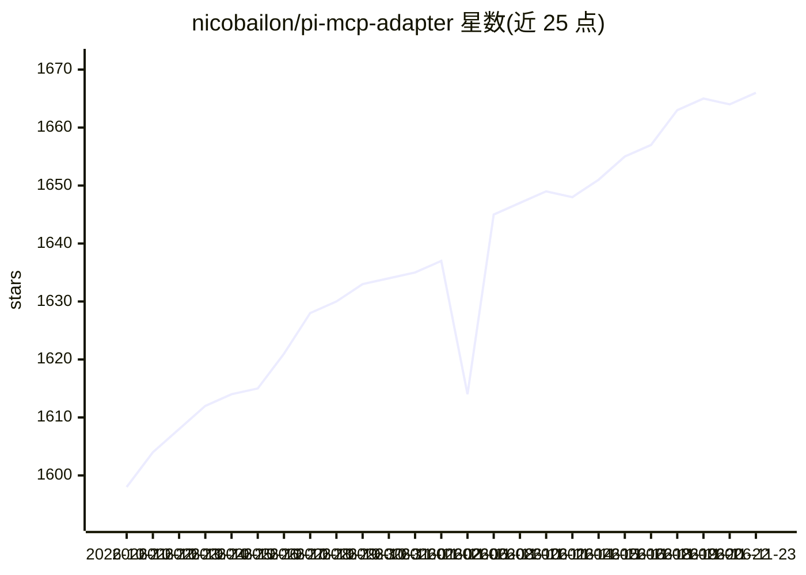

# nicobailon/pi-mcp-adapter

⭐ 1,666 · TypeScript · MIT · 推送 2026-11-21 · [GitHub](https://github.com/nicobailon/pi-mcp-adapter) · 个人维护

**Pi 编码代理的 MCP 适配器：按需加载工具以节省上下文**

为 Pi 编码代理提供的 MCP 适配器扩展，以单个代理工具（约 200 token）替代全部工具定义常驻上下文；服务器默认懒启动、空闲 10 分钟后停止，工具可通过文字或语义搜索按需调用，`extract` 从长结果中只返回指定字段。安装时自动替换 Pi 内置 MCP，支持 stdio/streamable HTTP/SSE 传输、OAuth 凭据存入系统钥匙串，并可导入 Cursor、Claude Code、Codex、VS Code 的既有配置。

## 筛选速览

| 维度 | 判定 | 备注 |
|---|---|---|
| AI 角色 | `ai-ecosystem` | LLM/agent 周边工具 |
| 许可风险 | `permissive` | MIT |
| 部署形态 | `None` |  |
| 模型依赖 | — | README 未给出锁定关系 |
| 硬件要求 | — | 无带数字的原话,不猜 |
| 安装摩擦 | `low` | 无编译、无系统依赖或容器化 |
| 成熟度 | — | 结构信号不足 |

## 能力要点

- 单个代理工具替代全部 MCP 工具定义，服务器懒启动并按空闲超时停止
- 工具搜索支持文字、正则与语义排序（借助 Pi 中可用的分类器模型）
- 导入 Cursor/Claude Code/Codex/VS Code 配置，OAuth 令牌存入 OS 钥匙串
- 支持 MCP Tasks 后台运行、elicitation、sampling、prompt 模板与 UI 应用

## 适用场景

- 在 Pi 会话中接入大量 MCP 服务器而不占用闲置上下文
- 把 Cursor/Claude Code 等工具中已配置的 MCP 服务器迁移到 Pi
- 让长任务在后台运行、代理继续工作
- 为常用 MCP 调用序列保存为固定输入的工具

## 场景标签

`编码 Agent` · 领域:编码与开发

## 证据(README 行号)

> L5: Use MCP servers with Pi without burning your context window.
> L21: But the MCP ecosystem has useful stuff - databases, browsers, APIs. This adapter gives you access without the bloat
> L25: Since then, Pi 0.99 added MCP support of its own, which also keeps tool definitions out of context. Installing the 

## 星数曲线

2026-10-21 1,598 → 2026-11-23 1,666（+68）

---
*卡片 v1 · prompt 1.4 · 生成 2026-11-23 · 置信度 high · 依据 README sha `5229a5a5edca` · [字段定义](../../DATASET.md)*
