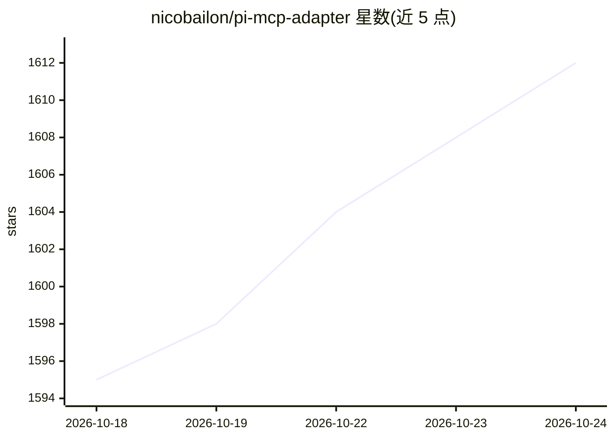

# nicobailon/pi-mcp-adapter

⭐ 1,612 · TypeScript · MIT · 推送 2026-10-22 · [GitHub](https://github.com/nicobailon/pi-mcp-adapter) · 个人维护

**让 Pi coding agent 以低 token 开销接入 MCP 服务器的适配器**

面向 Pi coding agent 用户的 MCP 适配层：以单个约 200 token 的 mcp 代理工具替代数百条工具定义，服务器默认懒启动（首次调用才连接，闲置 10 分钟自动停止），工具元数据缓存到磁盘供离线搜索。支持 stdio/streamable HTTP/legacy SSE/rmcp-mux 传输、OAuth 凭据存入 OS keychain、语义化工具搜索（需 System One key），并可导入 Cursor/Claude Code/Codex/VS Code 的既有 MCP 配置。安装后会关闭 Pi 内置 MCP 以避免双跑。以 npm 包经 pi install 安装。

## 筛选速览

| 维度 | 判定 | 备注 |
|---|---|---|
| AI 角色 | `ai-ecosystem` | LLM/agent 周边工具 |
| 许可风险 | `permissive` | MIT |
| 部署形态 | `None` |  |
| 模型依赖 | — | README 未给出锁定关系 |
| 硬件要求 | — | 无带数字的原话,不猜 |
| 安装摩擦 | `low` | 无编译、无系统依赖或容器化 |
| 成熟度 | — | 结构信号不足 |

## 能力要点

- 单个约 200 token 的 mcp 代理工具替代数百条工具定义
- 服务器懒启动：首次调用才连接，闲置 10 分钟自动停止
- 导入 Cursor/Claude Code/Codex/VS Code 既有 MCP 配置（/mcp-adapter setup）
- OAuth 凭据默认存入 OS keychain，支持语义化工具搜索

## 适用场景

- 在 Pi 中使用大量 MCP 服务器而不占满上下文窗口
- 把 Cursor/Claude Code 等已有的 MCP 配置迁移到 Pi
- 通过自然语言按需搜索和调用 MCP 工具

## 场景标签

 · 领域:AI 开发者工具/MCP 基础设施

## 证据(README 行号)

> L5: Use MCP servers with Pi without burning your context window.
> L15: But the MCP ecosystem has useful stuff - databases, browsers, APIs. This adapter gives you access without the bloat
> L156: - One `mcp` tool in context (~200 tokens) instead of hundreds

## 星数曲线

2026-10-18 1,595 → 2026-10-24 1,612（+17）

---
*卡片 v1 · prompt 1.4 · 生成 2026-10-21 · 置信度 high · 依据 README sha `20b79ca41ac0` · [字段定义](../../DATASET.md)*
