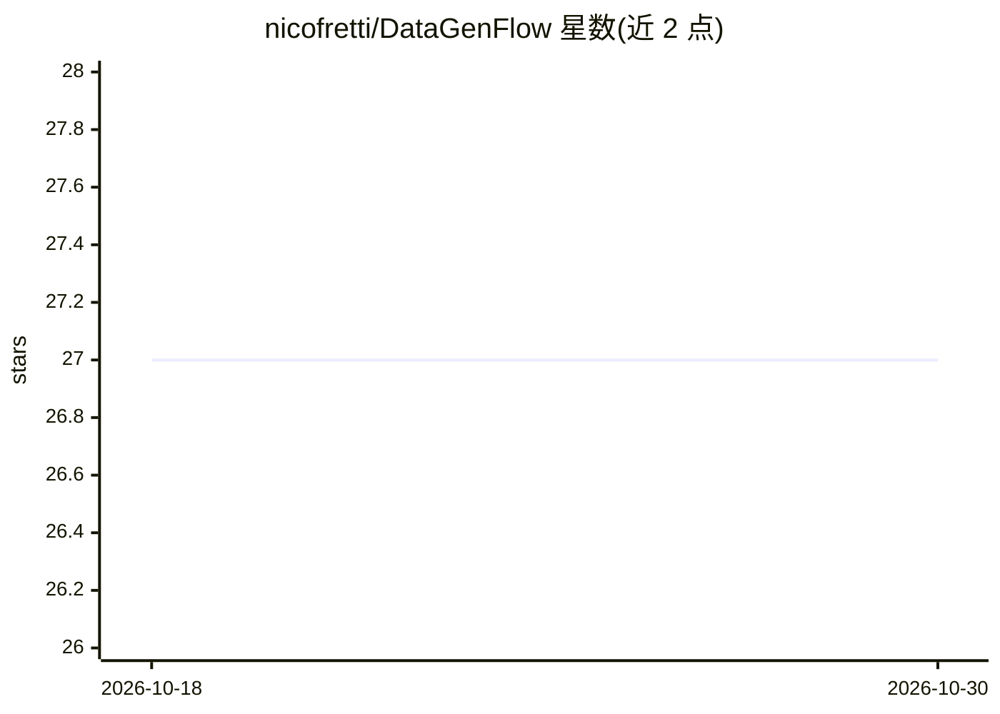

# nicofretti/DataGenFlow

⭐ 27 · Python · Apache-2.0 · 推送 2026-03-08 · [GitHub](https://github.com/nicofretti/DataGenFlow) · [官网](https://datagenflow.com) · 个人维护

**可视化流水线工具：从种子/文档生成并校验 LLM 数据集**

面向需要构建微调数据集的开发者的最小化工具：以 JSON 种子定义生成变量，通过拖拽式可视化流水线串联生成器、校验器与指标块（文本生成、JSON schema 校验、ROUGE/多样性评分等），各块输出累积到共享状态供后续块访问。支持将自定义块放入 user_blocks/ 目录自动发现，可配合本地或远程 LLM 端点（如 Ollama、OpenAI 兼容接口）运行。结果支持键盘快捷键人工审核（接受/拒绝/编辑），按状态筛选导出为 JSONL。需从源码运行（make setup/dev），要求 Python 3.10+。

## 筛选速览

| 维度 | 判定 | 备注 |
|---|---|---|
| AI 角色 | `ai-ecosystem` | LLM/agent 周边工具 |
| 许可风险 | `permissive` | Apache-2.0 |
| 部署形态 | `None` |  |
| 模型依赖 | local-ok | 支持本地模型 |
| 硬件要求 | — | 无带数字的原话,不猜 |
| 安装摩擦 | `low` | 无编译、无系统依赖或容器化 |
| 成熟度 | — | 结构信号不足 |

## 能力要点

- 拖拽式可视化流水线，含生成器/校验器/指标三类内置块
- 累积状态机制：各块输出自动对后续块可见，无需手动连线
- 自定义块放入 user_blocks/ 即自动发现，无需配置
- 人工审核（Accept/Reject/Edit）后按状态导出 JSONL

## 适用场景

- 为 LLM 微调构建带校验的合成数据集
- 从 markdown 文档分块生成结构化训练数据
- 在导出前人工筛选并追踪每条数据的生成过程

## 场景标签

 · 领域:LLM 数据工程

## 证据(README 行号)

> L19: DataGenFlow is minimal tool to help you generate and validate data from seed/documents with full visibility.
> L87: - [Generator] Text Generator: Generate text using LLM with configurable parameters
> L149: LLM_ENDPOINT=http://localhost:11434/v1/chat/completions  # Ollama, OpenAI, etc.

## 星数曲线

2026-10-18 27 → 2026-10-30 27（+0）

---
*卡片 v1 · prompt 1.4 · 生成 2026-10-26 · 置信度 high · 依据 README sha `7cf5c5e5fb96` · [字段定义](../../DATASET.md)*
