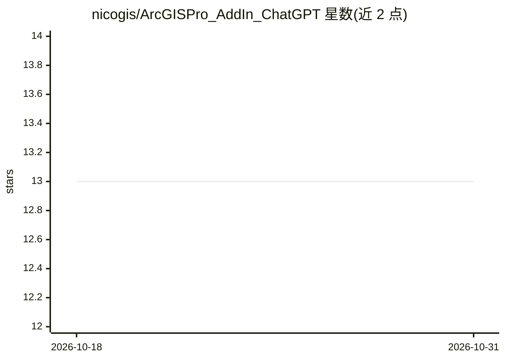

# nicogis/ArcGISPro_AddIn_ChatGPT

⭐ 13 · C# · Apache-2.0 · 推送 2026-10-15 · [GitHub](https://github.com/nicogis/ArcGISPro_AddIn_ChatGPT) · 个人维护

**ArcGIS Pro 内调用 ChatGPT 的基础 AddIn 插件**

面向 ArcGIS Pro 3.1 的 WPF AddIn 插件，在桌面 GIS 软件内提供 ChatGPT 调用窗口。支持 OpenAI 与 OpenAI Azure 两种 API，认证方式为 API Key（Azure 需填资源名、deployment id 与 API Key），可在设置中指定模型与 API 版本。README 自述为基础实现，并提示 ArcGIS Pro 3.5 起建议改用 ArcGIS Pro AI Assistants（beta）以对接 Custom Agents。使用前需在 ArcGIS Pro 选项中配置 ChatGPT 项。

## 筛选速览

| 维度 | 判定 | 备注 |
|---|---|---|
| AI 角色 | `ai-enhanced` | 去掉 AI 部分产品仍成立 |
| 许可风险 | `permissive` | Apache-2.0 |
| 部署形态 | `None` |  |
| 模型依赖 | — | README 未给出锁定关系 |
| 硬件要求 | — | 无带数字的原话,不猜 |
| 安装摩擦 | `low` | 无编译、无系统依赖或容器化 |
| 成熟度 | — | 结构信号不足 |

## 能力要点

- 在 ArcGIS Pro 内以 AddIn 按钮方式调用 ChatGPT
- 支持 OpenAI 与 OpenAI Azure 两种 API 及各自认证配置
- README 提示 ArcGIS Pro 3.5 起推荐迁移至 AI Assistants（beta）

## 适用场景

- 在 ArcGIS Pro 工作流中直接提问 ChatGPT
- 以 Azure OpenAI 部署接入企业环境的 GIS 助手对话

## 场景标签

`聊天机器人` · 领域:对话与助手

## 证据(README 行号)

> L3: Call ChatGTP from ArcGIS Pro (this is a basic implementation)
> L7: Set in ArcGIS Pro Options -> **ChatGPT** before using it

## 星数曲线

2026-10-18 13 → 2026-10-31 13（+0）

---
*卡片 v1 · prompt 1.4 · 生成 2026-10-31 · 置信度 mid · 依据 README sha `a0cac2ef21ce` · [字段定义](../../DATASET.md)*
