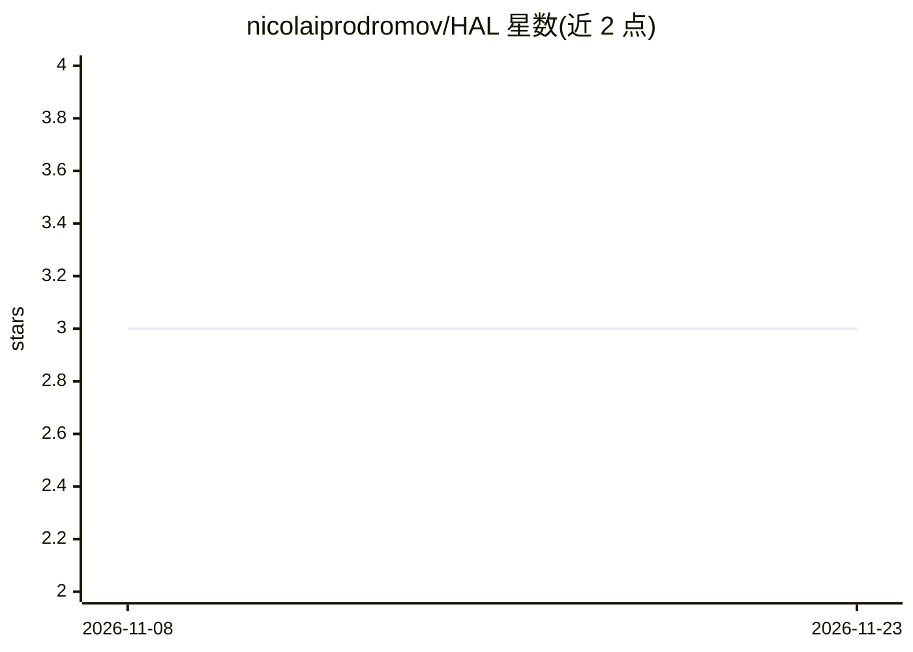

# nicolaiprodromov/HAL

⭐ 3 · Rust · Apache-2.0 · 推送 2026-11-06 · [GitHub](https://github.com/nicolaiprodromov/HAL) · 个人维护

**用自然语言伪代码驱动多智能体流水线执行任务的解释器**

HAL 是用 Rust 编写的解释器：用户用纯英文写 `.hal` 脚本，经四个 agent 流水线处理——Interpreter 与 Architect 把文本转成程序，Conductor 在 Docker 容器内确定性地执行，Reflector 在容器退出后读取运行结果并把观察写入共享 SQLite 记忆，供下次构建复用。面向想以自然语言快速实验和原型、不接触代码的开发者与研究者。构建产物缓存在源文件旁的 `.hal/` 项目目录，源码哈希未变则跳过前两个阶段。作者声明为 AI 部分参与编写的早期研究项目，开发节奏慢。

## 筛选速览

| 维度 | 判定 | 备注 |
|---|---|---|
| AI 角色 | `ai-ecosystem` | LLM/agent 周边工具 |
| 许可风险 | `permissive` | Apache-2.0 |
| 部署形态 | `library` | 以包/库形式分发 |
| 模型依赖 | — | README 未给出锁定关系 |
| 硬件要求 | — | 无带数字的原话,不猜 |
| 安装摩擦 | `low` | 无编译、无系统依赖或容器化 |
| 成熟度 | `idea` | |

## 能力要点

- 自然语言 .hal 脚本经 Interpreter→Architect→Conductor→Reflector 四 agent 流水线执行
- Conductor 为确定性 Rust 代码，容器编排不经 LLM 即兴生成
- Reflector 读取运行输出并写入共享记忆，闭环影响下次构建
- 记忆库无 API key 时回退到时间+子串匹配，可离线测试

## 适用场景

- 用英文描述需求直接生成并运行小型程序或脚本
- 编写英文版定时任务调度器
- 在终端做快速实验原型而无需编写构建文件

## 场景标签

`多智能体` `代码生成` · 领域:Agent 开发

## 证据(README 行号)

> L17: `hal` takes a plain-English `.hal` file, runs it through a four-agent
> L135: |Conductor|artifacts → running|**deterministic** Rust (bollard) — runs the container|
> L138: The Conductor stays deterministic on purpose — Docker orchestration is

## 星数曲线

2026-11-08 3 → 2026-11-23 3（+0）

---
*卡片 v1 · prompt 1.4 · 生成 2026-11-21 · 置信度 high · 依据 README sha `5f4672ea6a0e` · [字段定义](../../DATASET.md)*
