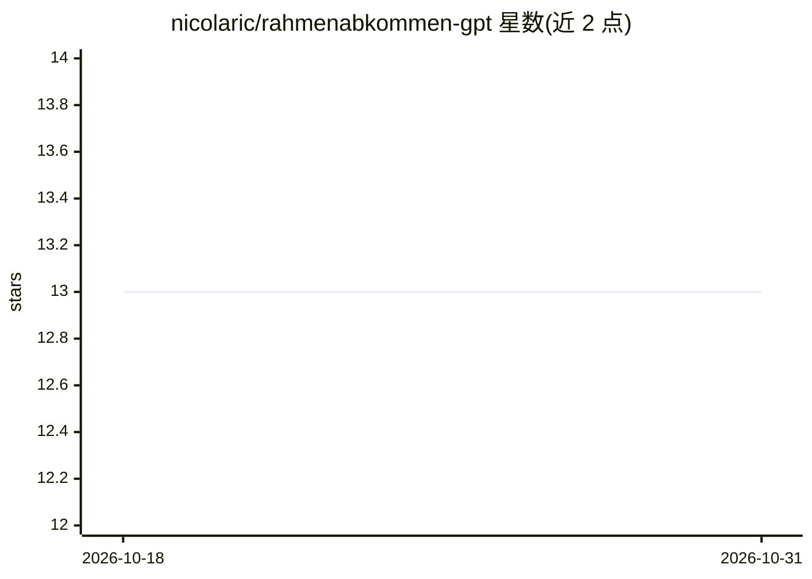

# nicolaric/rahmenabkommen-gpt

⭐ 13 · HTML · MIT · 推送 2026-10-26 · [GitHub](https://github.com/nicolaric/rahmenabkommen-gpt) · [官网](https://rahmenabkommen-gpt.ch) · 个人维护

**瑞士-欧盟框架协定官方文本问答应用（RAG）**

面向公众的 Web 问答应用：用户以自然语言询问瑞士与欧盟新框架协定（Rahmenabkommen/Bilaterale III）相关问题，系统从官方 PDF 条约文本中抽取与切分段落，建立向量索引（FAISS），结合语义检索与 prompt completion 生成仅基于官方文本的中立事实性回答。后端为 Python/Flask + SQLite + FAISS，前端为 Remix(React)，通过 Gunicorn 部署，需 Linux/macOS 或 WSL 运行 shell 脚本。

## 筛选速览

| 维度 | 判定 | 备注 |
|---|---|---|
| AI 角色 | `ai-native` | 本体是模型或模型工具 |
| 许可风险 | `permissive` | MIT |
| 部署形态 | `library` | 以包/库形式分发 |
| 模型依赖 | — | README 未给出锁定关系 |
| 硬件要求 | — | 无带数字的原话,不猜 |
| 安装摩擦 | `low` | 无编译、无系统依赖或容器化 |
| 成熟度 | — | 结构信号不足 |

## 能力要点

- 从官方条约 PDF 抽取、切分并做向量嵌入，FAISS 相似检索
- 回答仅基于官方条约文本，声明不含观点与推测
- Flask REST API + Remix/React 前端的全栈结构

## 适用场景

- 查询瑞士-欧盟框架协定条文内容
- 获取有官方文本出处的中立解答

## 场景标签

`文档问答` · 领域:知识与检索

## 证据(README 行号)

> L8: This app allows users to ask natural-language questions about the "Rahmenabkommen/Bilaterale III" (framework agreeme
> L17: - **FAISS** for fast vector similarity search

## 星数曲线

2026-10-18 13 → 2026-10-31 13（+0）

---
*卡片 v1 · prompt 1.4 · 生成 2026-10-31 · 置信度 high · 依据 README sha `5a2c992f6cfc` · [字段定义](../../DATASET.md)*
