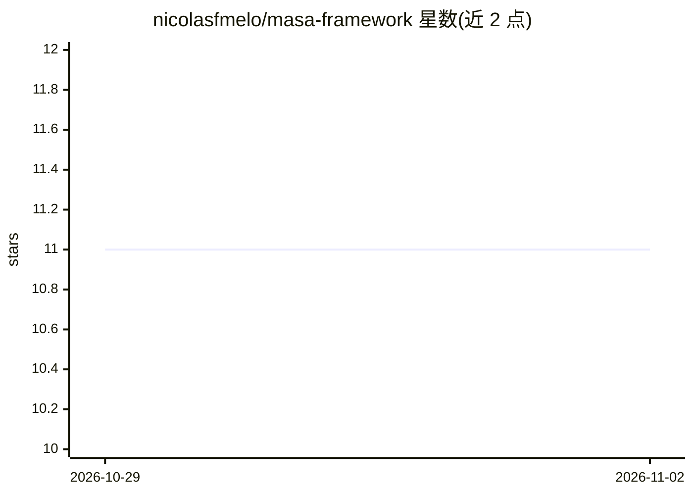

# nicolasfmelo/masa-framework

⭐ 11 · Python · NOASSERTION · 推送 2026-03-27 · [GitHub](https://github.com/nicolasfmelo/masa-framework) · [官网](https://www.masa-framework.org) · 个人维护

**面向 AI 编码代理的代码架构规范：让 agent 更易理解与安全修改代码**

MASA（Modular Agentic Semantic Architecture）是一套架构规范框架，目标是提升代码对 AI 编码代理的可认知性（cognizability），使其仅凭静态检查即可理解、导航并安全修改代码库。核心为四大支柱（语义命名、静态依赖可追溯、基础设施隔离、分层强制）与五层单向依赖架构。使用方式是将 specification/SKILL.md 加载为 AI 代理的上下文/自定义指令；README 报告了三个复杂度层级的对照实验（对比 DDD/Clean 架构基线，MASA 架构违规为 0）。仓库以规范文档与实验为主，许可证为 CC BY 4.0。

## 筛选速览

| 维度 | 判定 | 备注 |
|---|---|---|
| AI 角色 | `ai-ecosystem` | LLM/agent 周边工具 |
| 许可风险 | `none` | NOASSERTION |
| 部署形态 | `None` |  |
| 模型依赖 | — | README 未给出锁定关系 |
| 硬件要求 | — | 无带数字的原话,不猜 |
| 安装摩擦 | `low` | 无编译、无系统依赖或容器化 |
| 成熟度 | — | 结构信号不足 |

## 能力要点

- 四大支柱：语义命名、静态依赖可追溯、基础设施隔离、分层强制
- 五层单向依赖架构（Domain→Engine→Service→Integration/Delivery）
- specification/SKILL.md 可加载为 AI 编码代理的上下文/指令文件
- README 报告三个案例的对照实验：MASA 架构违规 0，基线 1–22

## 适用场景

- 让 GitHub Copilot 等 AI 编码代理按 MASA 规则生成与修改代码
- 新项目按 MASA 五层结构组织 Python/JS/Go 代码
- 查阅实验数据了解架构对 agent 修改代码行为的影响

## 场景标签

 · 领域:软件工程/架构规范

## 证据(README 行号)

> L3: > An architecture framework designed to maximize **cognizability** — the degree to which AI agents can understand, n
> L57: The `specification/SKILL.md` file is designed to be loaded as context for AI coding agents. It contains the complet

## 星数曲线

2026-10-29 11 → 2026-11-02 11（+0）

---
*卡片 v1 · prompt 1.4 · 生成 2026-11-01 · 置信度 mid · 依据 README sha `952e87482157` · [字段定义](../../DATASET.md)*
