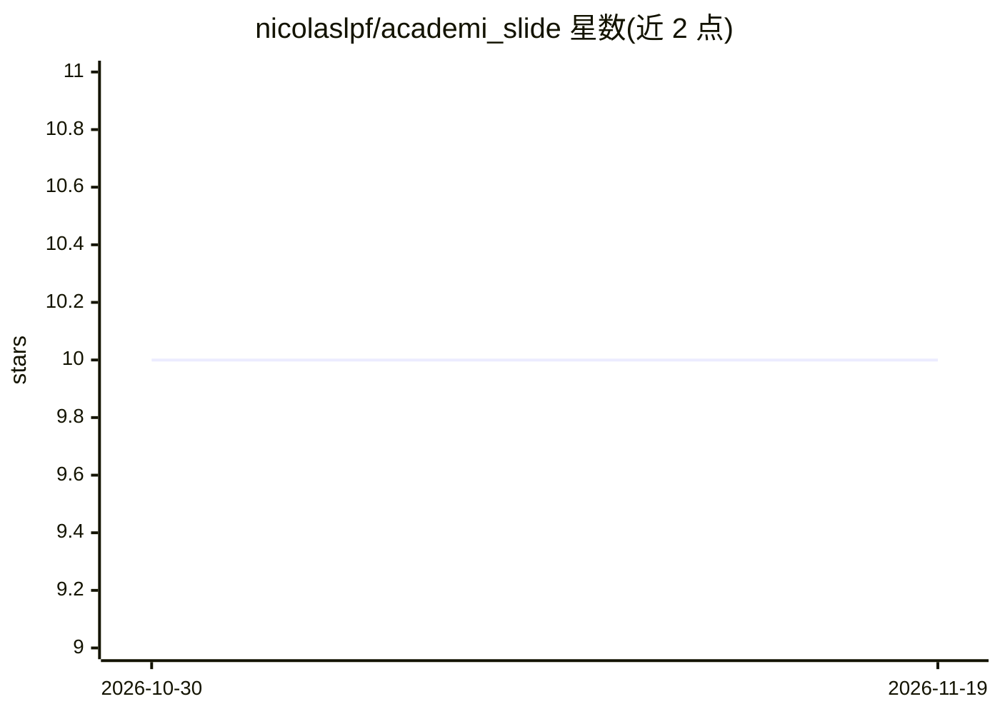

# nicolaslpf/academi_slide

⭐ 10 · Python · MIT · 推送 2026-08-06 · [GitHub](https://github.com/nicolaslpf/academi_slide) · 个人维护

**让本地 LLM 把学术 PDF 转成演示文稿或书面摘要**

以 Python 脚本运行的本地文档转换工具：读取学术 PDF，基于几何与字体的结构解析器抽取章节、表格与图，调用 OpenAI 兼容端点的 LLM 生成带主题、演讲者备注的 .pptx 或 Markdown 摘要。主打全程本地离线运行，论文不上传；支持 30 种语言的检测与翻译输出，引用与数字经回读校验后未锚定的会被移除。默认端点 localhost:1234/v1，需自备 OpenAI 兼容服务器；README 自称版本 0.9、进行中。

## 筛选速览

| 维度 | 判定 | 备注 |
|---|---|---|
| AI 角色 | `ai-native` | 本体是模型或模型工具 |
| 许可风险 | `permissive` | MIT |
| 部署形态 | `library` | 以包/库形式分发 |
| 模型依赖 | — | README 未给出锁定关系 |
| 硬件要求 | — | 无带数字的原话,不猜 |
| 安装摩擦 | `low` | 无编译、无系统依赖或容器化 |
| 成熟度 | `idea` | |

## 能力要点

- 结构化 PDF 解析器：几何/字体规则推断章节、表格、图位置，表格重建为可编辑 PowerPoint 表格
- 30 种语言自动检测与翻译输出，语言词表集中在 lexicon 数据层
- 引用/数字/图引用回读锚定校验，未锚定项移除
- 断点续跑、模型输出修复重试，torch-free 安装

## 适用场景

- 把不能上传到第三方服务的在审/保密论文转成演示文稿
- 阅读非英语论文并按需翻译成其他语言
- 长论文超出小模型上下文时做分段摘要

## 场景标签

`文档解析` `科研工具` · 领域:知识与检索

## 证据(README 行号)

> L21: third party. AcademiSlide runs against a local model on your own hardware — no
> L43: python main.py paper.pdf --format md -L English    # → outputs/paper.md
> L147: python main.py paper.pdf

## 星数曲线

2026-10-30 10 → 2026-11-19 10（+0）

---
*卡片 v1 · prompt 1.4 · 生成 2026-11-19 · 置信度 high · 依据 README sha `44bdc50cf135` · [字段定义](../../DATASET.md)*
