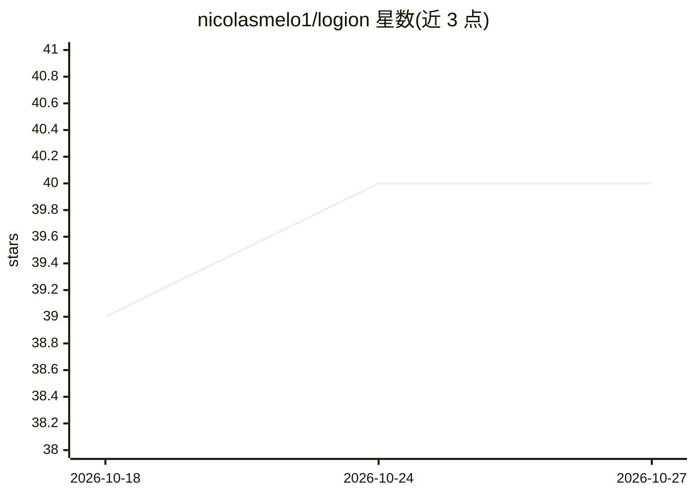

# nicolasmelo1/logion

⭐ 40 · Python · MIT · 推送 2026-10-09 · [GitHub](https://github.com/nicolasmelo1/logion) · [官网](https://logion.sh) · 个人维护

**AI agent 制品行为度量与注册层：验证技能/插件是否真的能用**

面向 agent 开发者的开源客户端工具（SDK/CLI/agent companion），对接 Logion 注册与度量服务：对 agent 安装的技能、插件、MCP 服务器、模型等制品做版本钉定的可复现评测，以分层标签（受控评测/静态证据/现场证据/尚无数据）发布带方法与限制的结论。集成 Trivy/OSV/agent-safety 信任管线、GitHub 身份绑定、赏金与积分经济。本仓库是客户端面，非平台本体；状态 beta，评测层标注为未发布。

## 筛选速览

| 维度 | 判定 | 备注 |
|---|---|---|
| AI 角色 | `ai-ecosystem` | LLM/agent 周边工具 |
| 许可风险 | `permissive` | MIT |
| 部署形态 | `library` | 以包/库形式分发 |
| 模型依赖 | — | README 未给出锁定关系 |
| 硬件要求 | — | 无带数字的原话,不猜 |
| 安装摩擦 | `low` | 无编译、无系统依赖或容器化 |
| 成熟度 | `idea` | |

## 能力要点

- 制品按精确版本+内容摘要+方法摘要钉定，结论至少复现两次才发布
- 四层标签化答案（受控评测/静态证据/现场证据/无测量），不合成单一分数
- 信任管线：Trivy·OSV Scanner·agent-safety 检查+人工审核
- 归因而非替代安装器：解析 npx skills、hf、git clone 等来源的精确版本

## 适用场景

- 安装 agent 技能前查证该版本是否有可复现的测量证据
- 为自建 agent 制品发布带方法与出处的行为评测
- 扫描制品的权限、许可证与 provenance 等静态证据

## 场景标签

`模型评测` · 领域:评测与运维

## 证据(README 行号)

> L18: Your agent installs skills, plugins, MCP servers and models that nobody has
> L37: This repository is the **open-source developer tooling** for that layer: the
> L63: 1. **Controlled evaluation** — our own measurement, reproducible from a pinned

## 星数曲线

2026-10-18 39 → 2026-10-27 40（+1）

---
*卡片 v1 · prompt 1.4 · 生成 2026-10-25 · 置信度 high · 依据 README sha `1d561556934f` · [字段定义](../../DATASET.md)*
