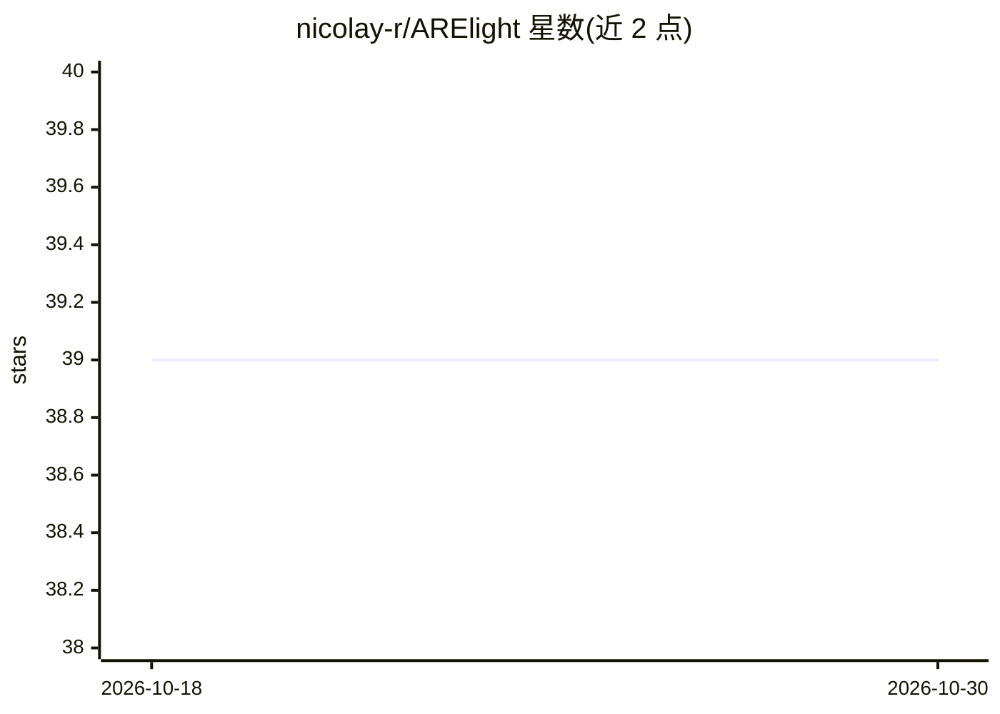

# nicolay-r/ARElight

⭐ 39 · Jupyter Notebook · MIT · 推送 2026-03-09 · [GitHub](https://github.com/nicolay-r/ARElight) · [官网](https://link.springer.com/chapter/10.1007/978-3-031-56069-9_23) · 个人维护

**从长文本中抽取命名实体间情感态度并生成图分析的应用**

基于 AREkit 的文本情感关系抽取应用：对大文档或文本集合进行上下文采样，通过 NER（DeepPavlov 或 Transformers 模型）标注实体，再由 LLM（默认经 Replicate 调用 Llama-3-70B-Instruct）分类实体间情感态度，结果以 force 布局图展示并可存入 SQLite；另提供图的 UNION/INTERSECTION/DIFFERENCE 操作以对比多组结果。支持非英文文本的可选翻译后端，附 GUI 服务器、Colab 与在线 Demo，为 ECIR-2024 演示论文配套仓库。

## 筛选速览

| 维度 | 判定 | 备注 |
|---|---|---|
| AI 角色 | `ai-native` | 本体是模型或模型工具 |
| 许可风险 | `permissive` | MIT |
| 部署形态 | `library` | 以包/库形式分发 |
| 模型依赖 | — | README 未给出锁定关系 |
| 硬件要求 | — | 无带数字的原话,不猜 |
| 安装摩擦 | `low` | 无编译、无系统依赖或容器化 |
| 成熟度 | — | 结构信号不足 |

## 能力要点

- 上下文采样 + NER + LLM 关系分类的情感态度抽取流水线
- NER 支持 DeepPavlov 与 Transformers 两类模型列表
- 结果图支持 UNION/INTERSECTION/DIFFERENCE 集合运算与权重模式
- 推理后端支持 Replicate（默认 meta/meta-llama-3-70b-instruct）

## 适用场景

- 分析政治人物等社交媒体文本中实体间的情感态度
- 对大规模文档集合做情感关系抽取并以图形式浏览
- 对比两组文本的实体关系图找出共性与差异

## 场景标签

`知识图谱` · 领域:知识与检索

## 证据(README 行号)

> L10: ARElight is an application for a granular view onto sentiments between mentioned named entities
> L77: * `bulk_chain` -- LLM framework, utilized for relations classification) [[bulk-chain]](https://github.com/nicolay-r
> L80:  * `inference-model-name` -- Name of the model; for the Replicate provider we use: `meta/meta-llama-3-70b-instruct`

## 星数曲线

2026-10-18 39 → 2026-10-30 39（+0）

---
*卡片 v1 · prompt 1.4 · 生成 2026-10-25 · 置信度 high · 依据 README sha `b6b4dec58efa` · [字段定义](../../DATASET.md)*
