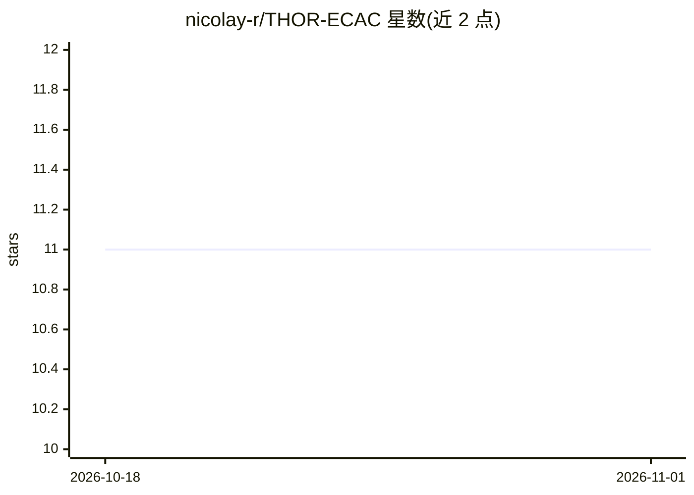

# nicolay-r/THOR-ECAC

⭐ 11 · Python · Apache-2.0 · 推送 2026-03-18 · [GitHub](https://github.com/nicolay-r/THOR-ECAC) · [官网](https://arxiv.org/abs/2404.03361) · 个人维护

**面向情感原因分析的 THoR 三跳推理框架（SemEval-2024 Task 3）**

原 THoR Chain-of-Thought 框架的 PyTorch 重构分支，适配 SemEval-2024 Task 3 情感原因对抽取任务：输入含说话人与文本的对话，输出情感-原因对（情感话语+类别+原因片段）。以 Flan-T5 系列为骨干推理模型（base 至 xxl），提供多步 thor 提示引擎、训练/评估/推理主脚本、数据下载序列化脚本与 Colab 复现笔记本；支持 bf16 模式使 xl 模型可在单张 NVidia-A100(40GB) 上训练。模型已上传 Hugging Face。代码以 Apache 2.0 限非商业使用发布，测试环境为 Python-3.8/3.10。

## 筛选速览

| 维度 | 判定 | 备注 |
|---|---|---|
| AI 角色 | `ai-native` | 本体是模型或模型工具 |
| 许可风险 | `permissive` | Apache-2.0 |
| 部署形态 | `library` | 以包/库形式分发 |
| 模型依赖 | — | README 未给出锁定关系 |
| 硬件要求 | — | 无带数字的原话,不猜 |
| 安装摩擦 | `low` | 无编译、无系统依赖或容器化 |
| 成熟度 | — | 结构信号不足 |

## 能力要点

- 三跳推理（情绪状态→原因）链式提示的 Flan-T5 实现
- 提供 prompt/thor_state/thor_cause/thor_cause_rr 多种推理引擎
- 支持 --bf16，xl 级模型可用单张 NVidia-A100(40GB) 微调
- 提供数据下载序列化脚本与 Colab 快速开始/实验复现笔记本

## 适用场景

- 复现 SemEval-2024 Task 3 情感原因对抽取实验
- 微调 Flan-T5 做对话中的情感原因推理研究
- 生成 Codalab 竞赛提交结果

## 场景标签

`微调` · 领域:训练与推理

## 证据(README 行号)

> L10: and adapted for SemEval-2024 paper
> L37: * **Output:** all emotion-cause pairs, where each pair contains an emotion utterance along with its emotion categor
> L89: Use the **Flan-T5** as the backbone LLM reasoner:

## 星数曲线

2026-10-18 11 → 2026-11-01 11（+0）

---
*卡片 v1 · prompt 1.4 · 生成 2026-11-01 · 置信度 high · 依据 README sha `91b45d0c6f82` · [字段定义](../../DATASET.md)*
