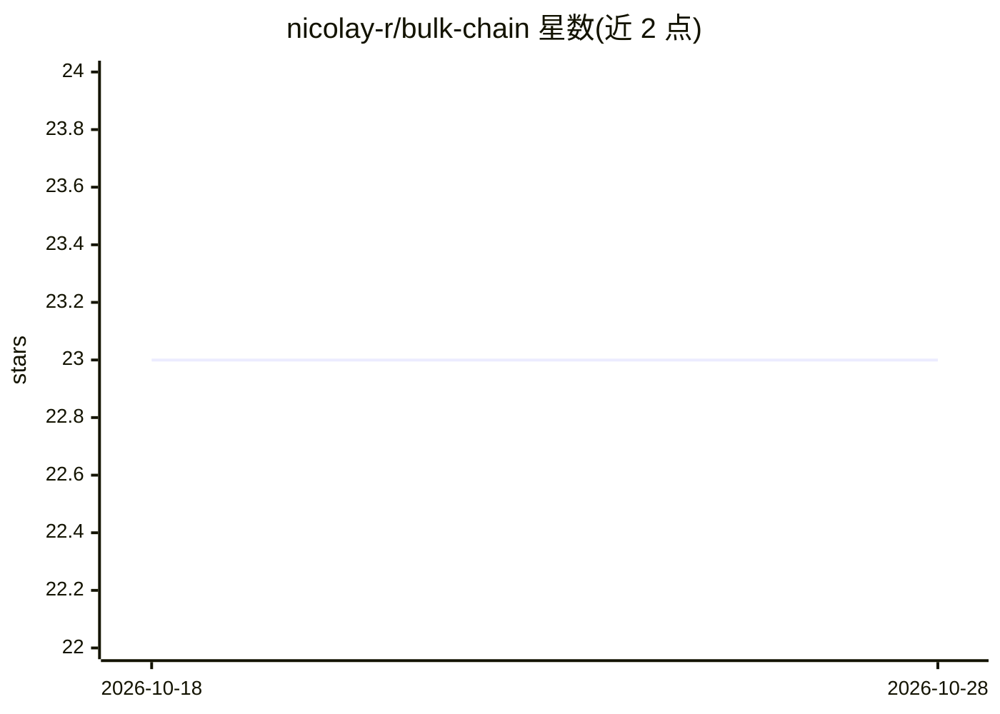

# nicolay-r/bulk-chain

⭐ 23 · Python · MIT · 推送 2026-09-25 · [GitHub](https://github.com/nicolay-r/bulk-chain) · [官网](https://x.com/nicolayr_/status/1847969224636961033) · 个人维护

**批量文本集合上应用 CoT 提示模式的 LLM 推理框架**

Python 框架 bulk-chain：以 JSON schema 声明 Chain-of-Thought 式提示步骤（prompt 与输出变量链），对大规模文本集合逐条迭代推理，输出经各步骤增强的文本条目。模型不内置，需从第三方 provider 托管服务接入；安装为 pip（--no-deps，依赖自由）。提供同步/异步、流式与批量的 ask 系列 API。README 列出 LangGraph workflow、ETL/dataflow、lite-llm 为相似概念。

## 筛选速览

| 维度 | 判定 | 备注 |
|---|---|---|
| AI 角色 | `ai-ecosystem` | LLM/agent 周边工具 |
| 许可风险 | `permissive` | MIT |
| 部署形态 | `library` | 以包/库形式分发 |
| 模型依赖 | — | README 未给出锁定关系 |
| 硬件要求 | — | 无带数字的原话,不猜 |
| 安装摩擦 | `low` | 无编译、无系统依赖或容器化 |
| 成熟度 | — | 结构信号不足 |

## 能力要点

- JSON schema 声明多步 CoT 提示链（prompt/out 变量）
- 迭代器方式处理大规模文本集合
- ask/ask_stream/ask_async 及 batch 系列 API
- 模型来自第三方 provider，pip install --no-deps 无强制依赖

## 适用场景

- 对大数据集文本批量执行多步 LLM 推理流水线
- 在自有应用中接入第三方 LLM 服务做 schema 化推理
- 构建类似 ETL 的 LLM 数据处理流程

## 场景标签

`提示工程` `工作流自动化` · 领域:Agent 开发

## 证据(README 行号)

> L10: A no-strings-attached **framework** for your LLM that allows applying Chain-of-Thought-alike prompt `schema` toward
> L14: * ✅ **Support schemas descriptions** for Chain-of-Thought concept.

## 星数曲线

2026-10-18 23 → 2026-10-28 23（+0）

---
*卡片 v1 · prompt 1.4 · 生成 2026-10-27 · 置信度 high · 依据 README sha `1fc2de9a5ad4` · [字段定义](../../DATASET.md)*
