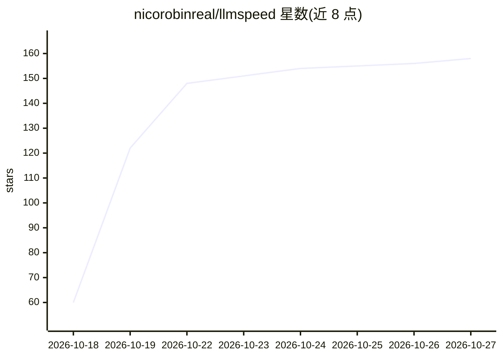

# nicorobinreal/llmspeed

⭐ 158 · TypeScript · MIT · 推送 2026-10-20 · [GitHub](https://github.com/nicorobinreal/llmspeed) · [官网](https://llmspeed.dev) · 个人维护

**本地 LLM 硬件速度预估网站：购卡前看真实流式速度**

静态网站，用户选择 GPU/Mac/CPU 与模型，按预估 tokens/sec 实时流式模拟输出，含首 token 等待时间、竞速模式与显存装填判定（权重+KV cache+运行时开销）。数据来自 r/LocalLLaMA、localscore.ai 等实测，无实测时按内存带宽与算力的第一性原理推算，每条结果标注 Measured/Derived/Projected 可信度。支持通过 PR 提交 llama-bench 实测数据。限制：不支持多 GPU，预估值与实际可有 10–30% 偏差。

## 筛选速览

| 维度 | 判定 | 备注 |
|---|---|---|
| AI 角色 | `ai-knowledge` | 知识聚合/清单类 |
| 许可风险 | `permissive` | MIT |
| 部署形态 | `library` | 以包/库形式分发 |
| 模型依赖 | — | README 未给出锁定关系 |
| 硬件要求 | — | 无带数字的原话,不猜 |
| 安装摩擦 | `medium` | 含编译或系统依赖之一 |
| 成熟度 | — | 结构信号不足 |

## 能力要点

- 按预估 tokens/sec 实时流式模拟，含首 token 延迟
- 30 种 GPU/Mac/CPU × 15 个模型，覆盖 CUDA/Metal/ROCm/Vulkan/CPU
- Memory fit 判定：完全装填/部分 offload 到内存/无法运行
- 每条数值标注 Measured/Derived/Projected 三级可信度

## 适用场景

- 买显卡前对比不同硬件跑某个模型的实际速度
- 判断模型在各量化级别下是否装进显存
- 并排竞速对比两套硬件配置

## 场景标签

`模型评测` · 领域:评测与运维

## 证据(README 行号)

> L17: - **Real-time simulation:** text streams at the predicted tokens/sec, after a realistic time to first token for you
> L33: **Sources.** Benchmarks are collected and verified from r/LocalLLaMA, localscore.ai, llama.cpp discussions and more
> L45: The most valuable contribution is a real measurement. To add one, open a PR that appends a row to `benchmarks/submi

## 星数曲线

2026-10-18 60 → 2026-10-27 158（+98）

---
*卡片 v1 · prompt 1.4 · 生成 2026-10-22 · 置信度 high · 依据 README sha `b53cfbde7e78` · [字段定义](../../DATASET.md)*
