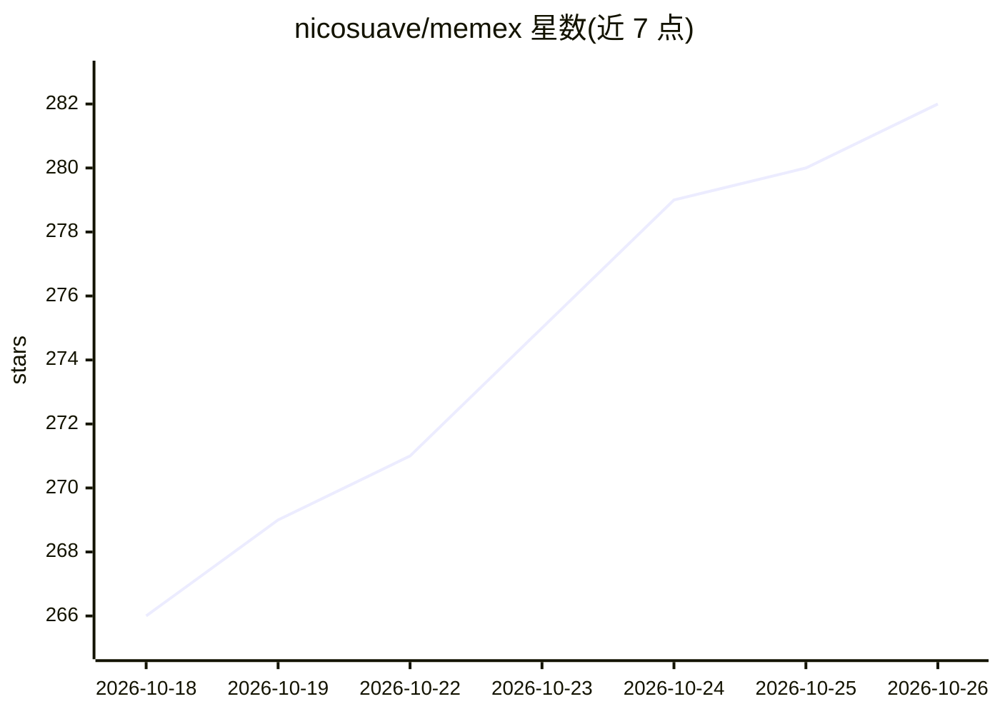

# nicosuave/memex

⭐ 282 · Rust · MIT · 推送 2026-10-24 · [GitHub](https://github.com/nicosuave/memex) · 个人维护

**本地编码 agent 会话历史的索引、搜索与恢复工具**

Memex 索引 Claude Code、Codex、Cursor、Copilot 等 18 种编码工具在本地保存的会话记录，提供 BM25 关键词搜索，可选本地嵌入实现语义与混合搜索；支持读取原始转录、在原工具中恢复会话、搜索 Claude/Codex 保存的记忆、通过 SSH 跨机器查询以及从本地日志重建 token 用量。接口形态包括 CLI、TUI、Web UI、macOS/Qt 应用、MCP 服务器与可安装给 agent 的搜索技能。恢复依赖对应工具已安装且会话数据仍存在，会话迁移功能标注为实验性且非无损。

## 筛选速览

| 维度 | 判定 | 备注 |
|---|---|---|
| AI 角色 | `ai-ecosystem` | LLM/agent 周边工具 |
| 许可风险 | `permissive` | MIT |
| 部署形态 | `None` |  |
| 模型依赖 | local-ok | 支持本地模型 |
| 硬件要求 | — | 无带数字的原话,不猜 |
| 安装摩擦 | `medium` | 含编译或系统依赖之一 |
| 成熟度 | `idea` | |

## 能力要点

- BM25 搜索 + 可选本地嵌入的语义/混合搜索
- 支持 18 种引擎的索引/搜索/读取，各引擎恢复与记忆能力有差异
- MCP 服务器与可安装搜索技能供 agent 调用检索
- SSH 跨机器查询与基于本地记录的 token 用量统计

## 适用场景

- 在多个编码工具的会话历史中找回以前做过的方案和决策
- 把旧会话恢复到原工具继续，或在工具间实验性迁移对话
- 让 agent 通过 MCP/技能检索我过往的会话记录作为上下文
- 统计各工具本地的 token 用量与成本估算

## 场景标签

`语义搜索` `Agent 记忆` · 领域:Agent 开发

## 证据(README 行号)

> L116: |MCP server|Give agents structured search and transcript retrieval tools|
> L181: Install the shared search skill for Codex, OpenCode, Pi, and Oh My Pi:

## 星数曲线

2026-10-18 266 → 2026-10-26 282（+16）

---
*卡片 v1 · prompt 1.4 · 生成 2026-10-22 · 置信度 high · 依据 README sha `b566e0ca364e` · [字段定义](../../DATASET.md)*
