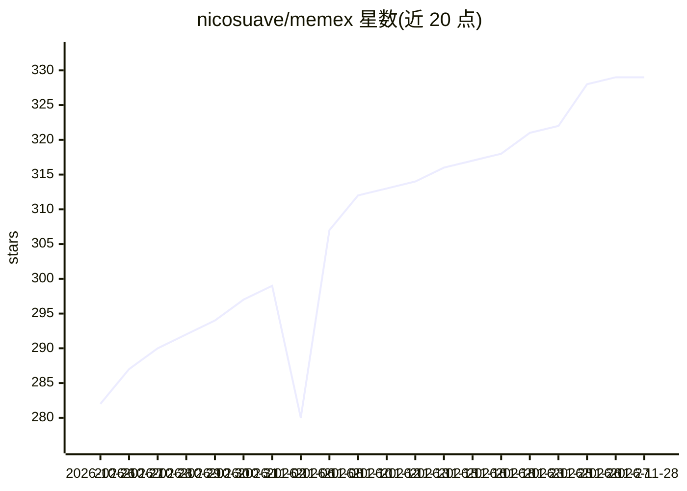

# nicosuave/memex

⭐ 329 · Rust · MIT · 推送 2026-11-23 · [GitHub](https://github.com/nicosuave/memex) · 个人维护

**索引并检索本地 AI 编码工具会话记录的终端工具**

Memex 将 Claude Code、Codex、Cursor、OpenCode 等 19 种 agent 工具的本地会话记录建立索引，提供 BM25 关键词检索，可选本地嵌入实现语义与混合检索；支持在 TUI/CLI/Web UI/macOS/Qt 多种界面中浏览转录原文、按项目/标签组织会话、通过 SSH 跨机器查询、统计 token 用量，并可在原工具中恢复会话。通过 MCP server 与搜索 skill 让 agent 自行调用检索。恢复功能依赖原工具已安装且会话数据仍存在。

## 筛选速览

| 维度 | 判定 | 备注 |
|---|---|---|
| AI 角色 | `ai-ecosystem` | LLM/agent 周边工具 |
| 许可风险 | `permissive` | MIT |
| 部署形态 | `None` |  |
| 模型依赖 | local-ok | 支持本地模型 |
| 硬件要求 | — | 无带数字的原话,不猜 |
| 安装摩擦 | `medium` | 含编译或系统依赖之一 |
| 成熟度 | — | 结构信号不足 |

## 能力要点

- 索引 19 种 agent 工具的本地会话记录，BM25 检索，可选本地嵌入混合搜索
- MCP server 与搜索 skill 供 agent 调用做有出处的历史召回
- memex dream 将近期历史合并为带引用的条目
- SSH 跨机器查询与 token 用量/成本估算报告

## 适用场景

- 找回之前在某个 agent 会话里做过的修改决策
- 让 Claude Code/Codex 在工作时检索自己以前的历史记录
- 统计各 agent 工具的 token 消耗与成本

## 场景标签

`语义搜索` · 领域:知识与检索

## 证据(README 行号)

> L3: Search, browse, and revisit your local agent history. Memex indexes conversations
> L124: |MCP server|Give agents structured search and transcript retrieval tools|
> L54: Support varies by capability. **History** means indexing, searching, and reading

## 星数曲线

2026-10-26 282 → 2026-11-28 329（+47）

---
*卡片 v1 · prompt 1.4 · 生成 2026-11-25 · 置信度 high · 依据 README sha `2d83fd7d5d30` · [字段定义](../../DATASET.md)*
