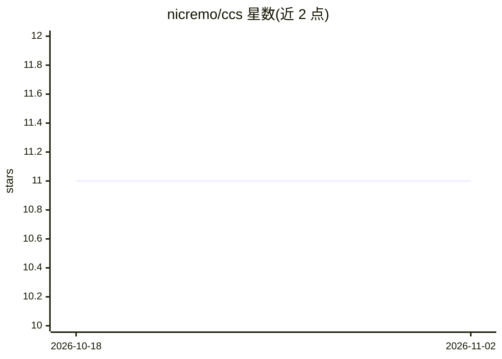

# nicremo/ccs

⭐ 11 · TypeScript · MIT · 推送 2026-07-05 · [GitHub](https://github.com/nicremo/ccs) · [官网](https://github.com/Nicremo/ccs) · 个人维护

**切换 Claude Code 后端模型的 CLI：免手改配置接入国产模型**

TypeScript/Node.js 编写的命令行工具，用于在 MiniMax、Kimi、Z.AI GLM、DeepSeek、Qwen/DashScope 等 Anthropic 兼容服务之间切换 Claude Code 的提供方。通过交互式向导选择供应商、区域与模型，用供应商专属请求头校验 API key，每次写入前备份 ~/.claude/settings.json，仅改写自身管理的 env 键，可用 ccs unload 撤销。本地优先存储配置，CLI 不回传数据。

## 筛选速览

| 维度 | 判定 | 备注 |
|---|---|---|
| AI 角色 | `ai-ecosystem` | LLM/agent 周边工具 |
| 许可风险 | `permissive` | MIT |
| 部署形态 | `library` | 以包/库形式分发 |
| 模型依赖 | locked-api |  |
| 硬件要求 | — | 无带数字的原话,不猜 |
| 安装摩擦 | `low` | 无编译、无系统依赖或容器化 |
| 成熟度 | — | 结构信号不足 |

## 能力要点

- 交互式向导选择供应商、区域、套餐与模型
- 写入前备份 Claude Code 设置，仅改写受管的 env 键
- ccs doctor 健康检查与 ccs unload 撤销配置
- 供应商目录基于官方文档维护，含模型 ID 与 base URL 映射

## 适用场景

- 在 Claude Code 里改用 MiniMax/Kimi/GLM/DeepSeek/Qwen 模型
- 多供应商之间频繁切换而不用手改 JSON
- 校验并集中管理各家供应商的 API key

## 场景标签

 · 领域:AI 开发者工具/CLI

## 证据(README 行号)

> L10: **CCS is a Claude Code provider switcher for Anthropic-compatible coding models.**
> L12: It configures Claude Code for MiniMax, Kimi, Z.AI GLM, DeepSeek, and Qwen without manually editing `~/.claude/setti

## 星数曲线

2026-10-18 11 → 2026-11-02 11（+0）

---
*卡片 v1 · prompt 1.4 · 生成 2026-11-01 · 置信度 high · 依据 README sha `0313e9ecf3ed` · [字段定义](../../DATASET.md)*
