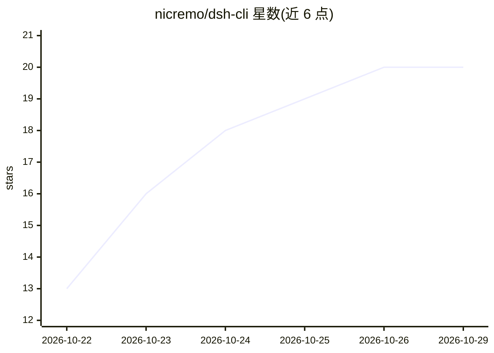

# nicremo/dsh-cli

⭐ 20 · JavaScript · MIT · 推送 2026-10-09 · [GitHub](https://github.com/nicremo/dsh-cli) · [官网](https://deepseekharnesscli.nicremo.de) · 个人维护

**让编码 agent 并行驱动 DeepSeek Harness 会话的 CLI**

面向 Claude Code、Codex、OpenCode、Pi 等编码 agent 的编排工具：通过非交互 CLI 命令（dsho）在 DeepSeek Harness 中批量启动并行研究/素材采集任务，结果合并为 INDEX.md，并附带 Agent Skill 教会 agent 何时委派任务。双后端：运行中的 DSH web UI（HTTP API）或 headless dsh 进程；无守护进程，状态存于 ~/.dsho/ 的 JSON 文件。附带 Playwright 截图与滚动视频功能。非官方社区项目，与 DeepSeek 无隶属关系。需 Node>=22.19 与已登录的 DeepSeek Harness，仅支持 macOS/Linux。

## 筛选速览

| 维度 | 判定 | 备注 |
|---|---|---|
| AI 角色 | `ai-ecosystem` | LLM/agent 周边工具 |
| 许可风险 | `permissive` | MIT |
| 部署形态 | `library` | 以包/库形式分发 |
| 模型依赖 | locked-api |  |
| 硬件要求 | — | 无带数字的原话,不猜 |
| 安装摩擦 | `medium` | 含编译或系统依赖之一 |
| 成熟度 | — | 结构信号不足 |

## 能力要点

- 并行研究批次：一题一 worker，dsho collect 合并为 INDEX.md
- 双后端：DSH web UI HTTP API 或 headless dsh（orchestra profile）
- 内置 Agent Skill，供 Claude Code/Codex/OpenCode/Pi 调用
- 全命令非交互、--json 输出与稳定退出码

## 适用场景

- 让编码 agent 并行研究多个主题并汇总结果
- 批量采集截图、滚动视频、新闻文章与素材（含来源与许可清单）
- 在 DSH web UI 中实时观看或介入批量会话

## 场景标签

`浏览器自动化` `网页抓取` · 领域:效率与自动化

## 证据(README 行号)

> L20: dsh-cli is **agent first**. Every command is non-interactive, returns at once, prints compact text or `--json`, and
> L42: 2. dsh-cli creates a workspace folder and one job per task, then hands each job to a detached runner and returns id

## 星数曲线

2026-10-22 13 → 2026-10-29 20（+7）

---
*卡片 v1 · prompt 1.4 · 生成 2026-10-28 · 置信度 mid · 依据 README sha `3f6ecfad60fa` · [字段定义](../../DATASET.md)*
