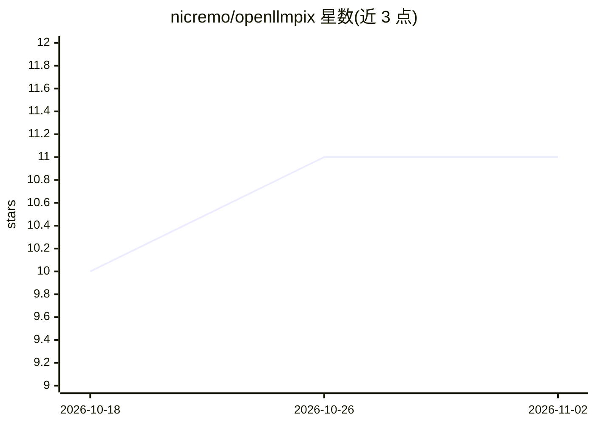

# nicremo/openllmpix

⭐ 11 · TypeScript · MIT · 推送 2026-04-13 · [GitHub](https://github.com/nicremo/openllmpix) · [官网](https://openllmpix.com) · 个人维护

**自托管的开源 AI 图像生成仪表盘，自带 API Key 多平台出图**

基于 Next.js/React/TypeScript 的图像生成前端：用户填入自己的 API Key，通过浏览器直接调用 Google AI Studio、OpenRouter、Fal.ai 的模型（Nano Banana Pro、Gemini、Imagen 3、FLUX 系列）生成图像。支持文生图、图生图与对话式编辑，5 种宽高比、批量 1-4 张、多参考图。API Key 以 AES-GCM 加密存储在浏览器本地，生成历史存 IndexedDB，Next.js 服务器仅提供静态前端。支持 Vercel 一键部署、npm 自托管或 Docker。

## 筛选速览

| 维度 | 判定 | 备注 |
|---|---|---|
| AI 角色 | `ai-native` | 本体是模型或模型工具 |
| 许可风险 | `permissive` | MIT |
| 部署形态 | `self-host` | docker 或自建部署 |
| 模型依赖 | locked-api |  |
| 硬件要求 | — | 无带数字的原话,不猜 |
| 安装摩擦 | `low` | 无编译、无系统依赖或容器化 |
| 成熟度 | — | 结构信号不足 |

## 能力要点

- 文生图/图生图/对话式编辑三种生成模式
- 接入 Google AI Studio、OpenRouter、Fal.ai 三类 Provider，自带 API Key
- API Key AES-GCM 加密存储于浏览器，请求经 CORS 直达 Provider，零服务器存储
- 本地 IndexedDB 保存生成历史，支持 Vercel/Docker 自托管

## 适用场景

- 用自己的 API Key 在统一界面调用多个图像生成模型
- 不经过中间服务平台、自托管地生成和管理 AI 图像
- 通过对话迭代编辑参考图像

## 场景标签

`图像生成` · 领域:内容生成

## 证据(README 行号)

> L24: So I built **OPENLLMPIX** — a clean, simple dashboard where I can use Nano Banana Pro (and other models) with my ow
> L72: |**Google AI Studio**|Nano Banana Pro, Gemini 2.0 Flash, Imagen 3|Text-to-Image, Image-to-Image*|aistudio.google.co

## 星数曲线

2026-10-18 10 → 2026-11-02 11（+1）

---
*卡片 v1 · prompt 1.4 · 生成 2026-11-01 · 置信度 high · 依据 README sha `358303878e64` · [字段定义](../../DATASET.md)*
