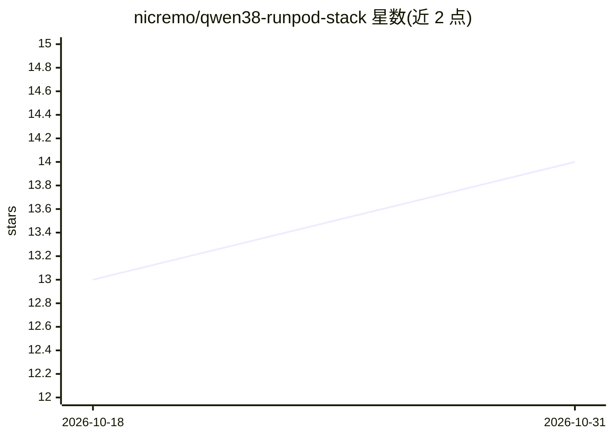

# nicremo/qwen38-runpod-stack

⭐ 14 · Shell · MIT · 推送 2026-08-23 · [GitHub](https://github.com/nicremo/qwen38-runpod-stack) · 个人维护

**一条命令在 RunPod 租用 GPU 上部署 Qwen3.8-27B 并接入本地编码 agent**

面向使用编码 agent 的开发者的 RunPod 部署工具链：通过 runpodctl 在租用的 RTX PRO 6000 上启动 pod，脚本在 pod 内下载权重并启动 SGLang，以 OpenAI 兼容 API 提供服务（README 实测约 150 tok/s，262K 上下文）；本地代理固定指向 127.0.0.1:8388 并自动跟随当前 pod。含三层成本控制（服务端定时器、rp 包装、reaper）与本地生成 API key 的安全措施。默认模型为去除安全对齐的 abliterated NVFP4 版本，声明仅用于研究、红队等用途；LaunchAgents 部分仅限 macOS。

## 筛选速览

| 维度 | 判定 | 备注 |
|---|---|---|
| AI 角色 | `ai-ecosystem` | LLM/agent 周边工具 |
| 许可风险 | `permissive` | MIT |
| 部署形态 | `None` |  |
| 模型依赖 | — | README 未给出锁定关系 |
| 硬件要求 | — | 无带数字的原话,不猜 |
| 安装摩擦 | `low` | 无编译、无系统依赖或容器化 |
| 成熟度 | — | 结构信号不足 |

## 能力要点

- 单命令启动 pod 并以 OpenAI 兼容 API 提供 Qwen3.8-27B 服务
- 本地代理固定 URL（127.0.0.1:8388）自动指向当前运行 pod
- 三层成本控制防止遗忘 pod 持续扣费
- qwen38bench 测量解码速率、TTFT 与接受 token 长度

## 适用场景

- 给自己的编码 agent 接入自托管的 Qwen3.8-27B
- 按需租用 GPU 跑 NVFP4 量化模型并控制费用
- 用 OpenWebUI 网页界面使用该模型

## 场景标签

`推理引擎` · 领域:训练与推理

## 证据(README 行号)

> L16: repo makes that a single command: it starts the pod, serves the model over an
> L17: OpenAI-compatible API, and gives your coding agent a **fixed local URL** that

## 星数曲线

2026-10-18 13 → 2026-10-31 14（+1）

---
*卡片 v1 · prompt 1.4 · 生成 2026-10-31 · 置信度 high · 依据 README sha `116906e9207e` · [字段定义](../../DATASET.md)*
