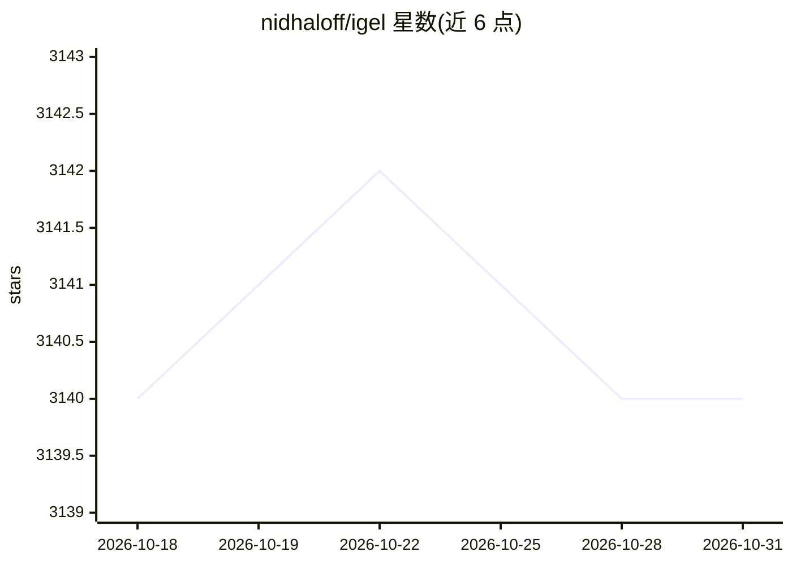

# nidhaloff/igel

⭐ 3,140 · Python · MIT · 推送 2025-12-07 · [GitHub](https://github.com/nidhaloff/igel) · [官网](https://igel.readthedocs.io/en/latest/) · 个人维护

**无代码机器学习 CLI 工具：用配置文件训练、评估、预测模型**

构建在其他 ML 框架之上的命令行工具，目标用户包括技术与非技术用户。用户通过 yaml/json 配置文件描述任务，或用 auto-ml 功能直接指定数据路径与任务（ImageClassification/TextClassification 等），igel 即完成数据处理、模型训练与优化。支持回归、分类、聚类，输入可为 csv/txt/excel/json/html 及原始图片文件夹，提供交叉验证、超参搜索、多输出、ONNX 导出，也可从 Python 调用。auto-ml 会尝试多种模型比较性能，计算开销较大。

## 筛选速览

| 维度 | 判定 | 备注 |
|---|---|---|
| AI 角色 | `ai-native` | 本体是模型或模型工具 |
| 许可风险 | `permissive` | MIT |
| 部署形态 | `self-host` | docker 或自建部署 |
| 模型依赖 | — | README 未给出锁定关系 |
| 硬件要求 | — | 无带数字的原话,不猜 |
| 安装摩擦 | `low` | 无编译、无系统依赖或容器化 |
| 成熟度 | — | 结构信号不足 |

## 能力要点

- yaml/json 配置驱动，无需编写代码即可 fit/evaluate/predict
- auto-ml 支持 ImageClassification/TextClassification 等任务，可直接喂原始数据
- 支持回归/分类/聚类共数十种算法与 sklearn 指标
- 可导出 sklearn 模型为 ONNX，也可从 Python 调用

## 适用场景

- 快速搭建机器学习原型或概念验证
- 不写代码对 csv/excel 数据做分类或回归预测
- 对图片/文本数据自动搜索可用模型

## 场景标签

 · 领域:机器学习/AutoML

## 证据(README 行号)

> L31: A delightful machine learning tool that allows you to train/fit, test and use models **without writing code**
> L61: Igel supports regression, classification and clustering.
> L170:  $ igel auto-train --data_path 'path_to_your_images_folder' --task ImageClassification

## 星数曲线

2026-10-18 3,140 → 2026-10-31 3,140（+0）

---
*卡片 v1 · prompt 1.4 · 生成 2026-10-21 · 置信度 high · 依据 README sha `91b6d73b6ad0` · [字段定义](../../DATASET.md)*
