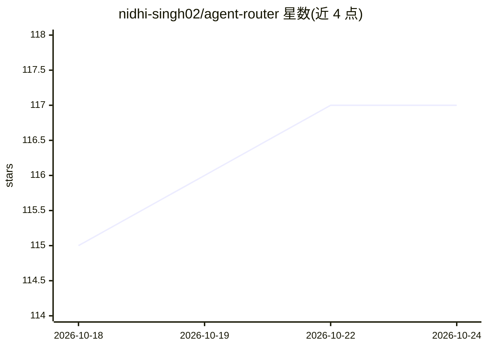

# nidhi-singh02/agent-router

⭐ 117 · TypeScript · MIT · 推送 2026-09-27 · [GitHub](https://github.com/nidhi-singh02/agent-router) · 个人维护

**配额感知的 CLI：为任务挑选 AI 编码 agent 与模型并启动**

面向 Herdr 终端用户的命令行路由工具：按固定规则（启用模型、配额、共享账户 40% 保留额）过滤订阅账户，调用 TypeSafe 对剩余候选做语义排序并选定推理档位，随后在 Herdr 面板中启动所选 agent（Cursor、Claude Code、Codex 或 OpenCode）并交付任务。配额默认从本地状态行缓存文件读取并持久化到 SQLite；配置、会话与决策记录留在本机。每次运行只路由一个阶段（规划/实现等），需 Node.js 20+、TypeSafe API key 与至少一个已登录的 agent CLI。

## 筛选速览

| 维度 | 判定 | 备注 |
|---|---|---|
| AI 角色 | `ai-ecosystem` | LLM/agent 周边工具 |
| 许可风险 | `permissive` | MIT |
| 部署形态 | `library` | 以包/库形式分发 |
| 模型依赖 | — | README 未给出锁定关系 |
| 硬件要求 | — | 无带数字的原话,不猜 |
| 安装摩擦 | `low` | 无编译、无系统依赖或容器化 |
| 成熟度 | `idea` | |

## 能力要点

- 规则先行：确定性资格过滤（配额/保留额）先于语义排序
- 支持 Cursor、Claude Code、Codex、OpenCode 四种 agent 通过同一命令启动
- 本地状态行缓存文件读取配额并持久化到 SQLite（0700/0600 权限修复）
- 分阶段会话链：规划→实现，卡片显示选择原因与上一会话

## 适用场景

- 多个 AI 编码订阅间按剩余配额自动分配任务
- 在 Herdr 中用一条命令为当前阶段选定 agent/模型/推理档位
- 共享账户上保留 40% 配额避免被路由耗尽

## 场景标签

`模型网关` · 领域:Agent 开发

## 证据(README 行号)

> L5: `router` is a command-line tool that picks an AI coding agent, model, and reasoning effort
> L13: shared accounts), asks TypeSafe to rank what is left and choose an effort, starts the chosen

## 星数曲线

2026-10-18 115 → 2026-10-24 117（+2）

---
*卡片 v1 · prompt 1.4 · 生成 2026-10-23 · 置信度 high · 依据 README sha `35d5b0d0390a` · [字段定义](../../DATASET.md)*
