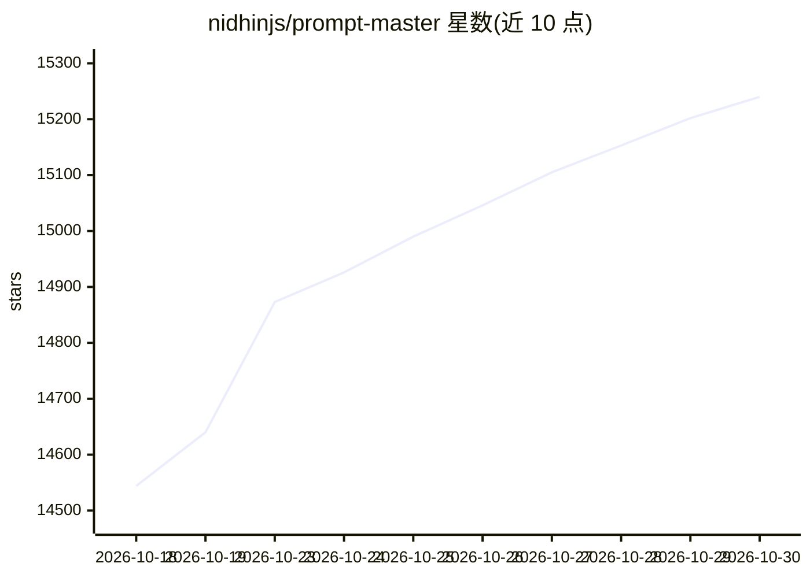

# nidhinjs/prompt-master

⭐ 15,240 · MIT · 推送 2026-10-22 · [GitHub](https://github.com/nidhinjs/prompt-master) · 个人维护

**给各 AI 工具写精准提示词的 Claude skill**

以 Claude skill 形式分发的提示词生成器：对用户请求运行结构化流水线——检测目标工具、提取 9 维意图、最多 3 个澄清问题、自动路由到 13 个提示词模板之一、应用 5 种声明为安全的技术、做 token 效率审计后输出单个可复制提示词。内置 30+ 工具 profile，未收录的工具用 4 问 Universal Fingerprint 处理。明确排除 Tree of Thought 等易幻觉方法。面向使用多个 AI 工具的普通用户。

## 筛选速览

| 维度 | 判定 | 备注 |
|---|---|---|
| AI 角色 | `ai-native` | 本体是模型或模型工具 |
| 许可风险 | `permissive` | MIT |
| 部署形态 | `None` |  |
| 模型依赖 | locked-api |  |
| 硬件要求 | — | 无带数字的原话,不猜 |
| 安装摩擦 | `low` | 无编译、无系统依赖或容器化 |
| 成熟度 | — | 结构信号不足 |

## 动量与使用信号

- 维护:`active` — 距上次 push 2.1 天,年发版 0,8 位贡献者
- 涨星:近 1 天 **+41**(自 20261016 起算)
- 平台:— · 协议:OLLAMA

## 能力要点

- 覆盖推理、编码、图像、视频、语音、自动化等 30+ 工具的专用 profile
- 13 个提示词模板自动选择并对用户隐藏框架名
- 检测 37 种浪费额度的提示词模式并给出改写
- max 3 个澄清问题与 token 效率审计机制

## 适用场景

- 为 Claude Code / Cursor 等编码工具生成任务提示词
- 为 Midjourney、Stable Diffusion 生成图像提示词
- 把写坏的提示词拆解并改写成适配其他工具的版本

## 场景标签

`提示工程` · 领域:Agent 开发

## 证据(README 行号)

> L1: A Claude skill that writes the accurate prompts for any AI tool. Zero tokens or credits wasted. Full context and mem
> L71: Prompt Master runs a structured pipeline on every request:

## 星数曲线

2026-10-18 14,544 → 2026-10-30 15,240（+696）

---
*卡片 v1 · prompt 1.4 · 生成 2026-10-18 · 置信度 high · 依据 README sha `50eeea47084a` · [字段定义](../../DATASET.md)*
