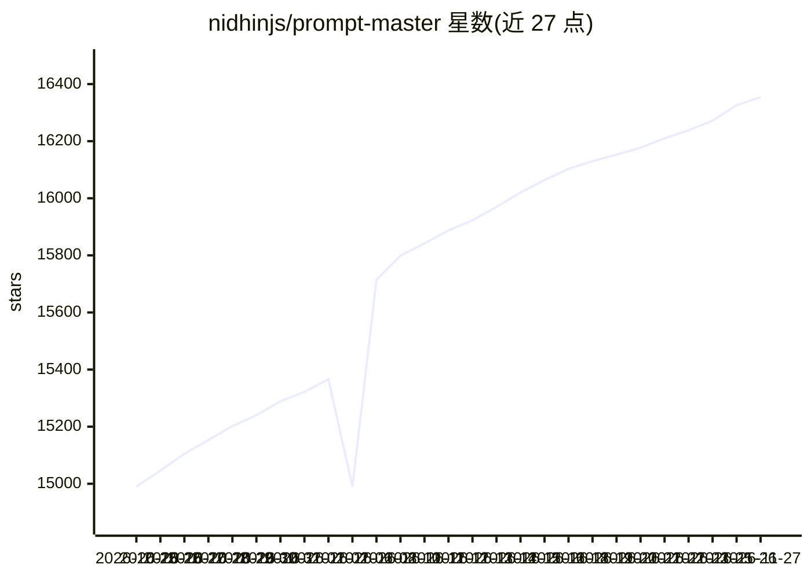

# nidhinjs/prompt-master

⭐ 16,354 · MIT · 推送 2026-10-22 · [GitHub](https://github.com/nidhinjs/prompt-master) · 个人维护

**为各类 AI 工具生成精准提示词的 Claude 技能**

一个安装到 Claude 的 skill：当用户需要给其他 AI 工具写提示词时被调用，运行 8 步结构化流水线——检测目标工具、提取 9 个意图维度、最多提 3 个澄清问题、自动路由到 14 种提示词模板之一、应用仅限 5 种安全技巧、做 token 效率审计后输出单块可复制提示词。内置 30+ 工具画像（覆盖 LLM、编码 agent、图像/视频/3D 生成、语音、工作流自动化等），未知工具走 Universal Fingerprint 4 问流程。安装方式为 claude.ai 上传 ZIP 或 clone 到 Claude Code skills 目录。

## 筛选速览

| 维度 | 判定 | 备注 |
|---|---|---|
| AI 角色 | `ai-native` | 本体是模型或模型工具 |
| 许可风险 | `permissive` | MIT |
| 部署形态 | `None` |  |
| 模型依赖 | — | README 未给出锁定关系 |
| 硬件要求 | — | 无带数字的原话,不猜 |
| 安装摩擦 | `low` | 无编译、无系统依赖或容器化 |
| 成熟度 | — | 结构信号不足 |

## 动量与使用信号

- 维护:`active` — 距上次 push 2.1 天,年发版 0,8 位贡献者
- 涨星:近 1 天 **+41**(自 20261016 起算)
- 平台:— · 协议:OLLAMA

## 能力要点

- 8 步流水线：意图提取→澄清提问→模板路由→token 效率审计
- 30+ 工具画像与 14 种自动选择的提示词模板
- 仅采用 5 种声明有界效果的技巧，明确排除易致幻觉的方法
- 通过 claude.ai 上传 ZIP 或 clone 至 Claude Code skills 目录安装

## 适用场景

- 给 Cursor 或 Claude Code 写重构/开发任务的提示词
- 为 Midjourney、Stable Diffusion 生成图像提示词并支持参考图编辑
- 把写坏的工具提示词粘贴进来改写优化

## 场景标签

`提示工程` · 领域:Agent 开发

## 证据(README 行号)

> L1: A Claude skill that writes the accurate prompts for any AI tool. Zero tokens or credits wasted. Full context and mem
> L73: 1. **Detects the target tool** — figures out which AI system the prompt is for and routes silently to the right app
> L120: Prompt Master includes specific profiles for 20+ tools. For anything not on the list, it uses a **Universal Finger

## 星数曲线

2026-10-25 14,990 → 2026-11-27 16,354（+1,364）

---
*卡片 v1 · prompt 1.4 · 生成 2026-11-22 · 置信度 high · 依据 README sha `36cd233f74e6` · [字段定义](../../DATASET.md)*
