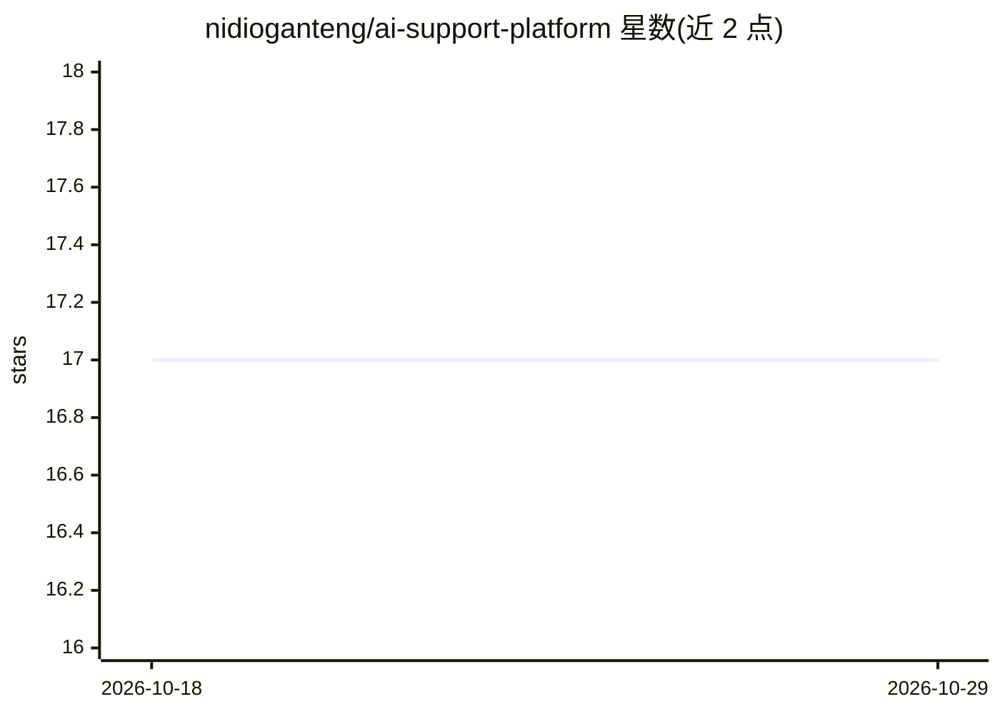

# nidioganteng/ai-support-platform

⭐ 17 · TypeScript · 推送 2026-08-05 · [GitHub](https://github.com/nidioganteng/ai-support-platform) · 个人维护

**多租户 AI 客服平台：企业上传文档即得 RAG 应答助手**

面向企业的多租户 AI 客服 SaaS 平台：商家上传文档、FAQ、PDF 或网站 URL，系统经后台任务完成解析、爬取与嵌入（Pinecone 向量库），客户获得基于该内容的 24/7 RAG 应答，并支持转接人工客服。技术栈为 Next.js + Express/TypeScript + BullMQ Worker + Prisma/PostgreSQL，集成 Clerk 认证、Resend 邮件与 Stripe 计费，OpenAI + LangChain 提供 AI 能力。以 pnpm monorepo 形式从源码运行，本地依赖 Docker 启动 Postgres 与 Redis。

## 筛选速览

| 维度 | 判定 | 备注 |
|---|---|---|
| AI 角色 | `ai-native` | 本体是模型或模型工具 |
| 许可风险 | `none` | — |
| 部署形态 | `library` | 以包/库形式分发 |
| 模型依赖 | — | README 未给出锁定关系 |
| 硬件要求 | — | 无带数字的原话,不猜 |
| 安装摩擦 | `low` | 无编译、无系统依赖或容器化 |
| 成熟度 | — | 结构信号不足 |

## 能力要点

- 多租户架构，商家自助上传文档/PDF/网站构建知识库
- BullMQ 后台任务处理 PDF 解析、爬取与嵌入计算
- RAG 应答 + 人工客服转接机制
- 集成 Clerk 认证、Stripe 计费、Resend 邮件

## 适用场景

- 中小企业搭建基于自有文档的 24/7 自动客服
- 多商家共用一套平台的客服 SaaS 运营
- 客服机器人无法解决时转接人工坐席

## 场景标签

`聊天机器人` `文档问答` · 领域:对话与助手

## 证据(README 行号)

> L3: Multi-tenant AI-powered customer support platform. Businesses upload docs,
> L4: FAQs, PDFs, and websites; customers get 24/7 AI-answered support backed by
> L17: - **AI**: OpenAI + LangChain

## 星数曲线

2026-10-18 17 → 2026-10-29 17（+0）

---
*卡片 v1 · prompt 1.4 · 生成 2026-10-29 · 置信度 mid · 依据 README sha `a9c4e58e2ac1` · [字段定义](../../DATASET.md)*
