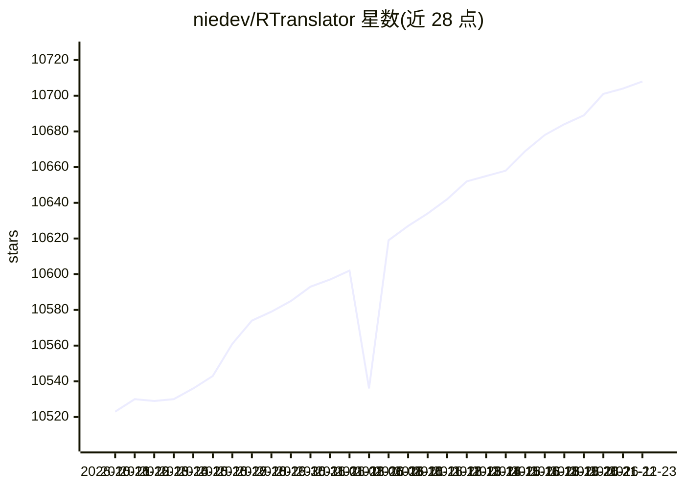

# niedev/RTranslator

⭐ 10,708 · Java · Apache-2.0 · 推送 2026-11-19 · [GitHub](https://github.com/niedev/RTranslator) · 个人维护

**安卓离线实时翻译应用：本地运行语音识别与翻译模型**

面向 Android 用户的开源离线实时翻译应用，提供三种模式：Conversation 模式通过 Bluetooth LE 连接另一台安装本应用的手机实现双向对话翻译，WalkieTalkie 模式用一部手机轮流快速对话并自动检测语言，另含经典文本翻译。翻译使用 NLLB/Mozilla Bergamot/Madlad/HY-MT 模型，语音识别使用 Whisper，均以 int8 量化 ONNX 格式本地运行，声称不收集任何数据。APK 从 GitHub Releases 下载，首次启动自动下载约 1.2GB 模型；运行需至少 6GB RAM 的手机，应用目前仍处于 beta 阶段。

## 筛选速览

| 维度 | 判定 | 备注 |
|---|---|---|
| AI 角色 | `ai-native` | 本体是模型或模型工具 |
| 许可风险 | `permissive` | Apache-2.0 |
| 部署形态 | `None` |  |
| 模型依赖 | — | README 未给出锁定关系 |
| 硬件要求 | — | 无带数字的原话,不猜 |
| 安装摩擦 | `low` | 无编译、无系统依赖或容器化 |
| 成熟度 | `idea` | |

## 能力要点

- Conversation/WalkieTalkie/文本翻译三种模式，支持蓝牙耳机
- NLLB 与 Whisper 转为 int8 量化 ONNX 并做 KV cache 等优化（NLLB RAM 从 2.5GB 降至 1.3GB）
- 本地离线运行，无服务器，不收集个人数据
- 3.0 版起 MLKit 替换为 FastText/Lingua，实现 100% 开源

## 适用场景

- 在国外街头快速问路时用 WalkieTalkie 模式与当地人对话
- 与说不同语言的朋友长时间面对面交谈
- 无网络环境下进行文本翻译

## 场景标签

`语音识别` · 领域:感知与多模态

## 证据(README 行号)

> L1: RTranslator is an (almost) open-source, free, and offline real-time translation app for Android.
> L40: RTranslator uses Meta\'s NLLB for translation and OpenAi\'s Whisper for speech recognition, both are (almost) open-
> L87: I have optimized the AI models a lot to minimize RAM consumption and execution time, despite this however to be abl

## 星数曲线

2026-10-21 10,523 → 2026-11-23 10,708（+185）

---
*卡片 v1 · prompt 1.4 · 生成 2026-11-22 · 置信度 high · 依据 README sha `d81b0e10ccb9` · [字段定义](../../DATASET.md)*
