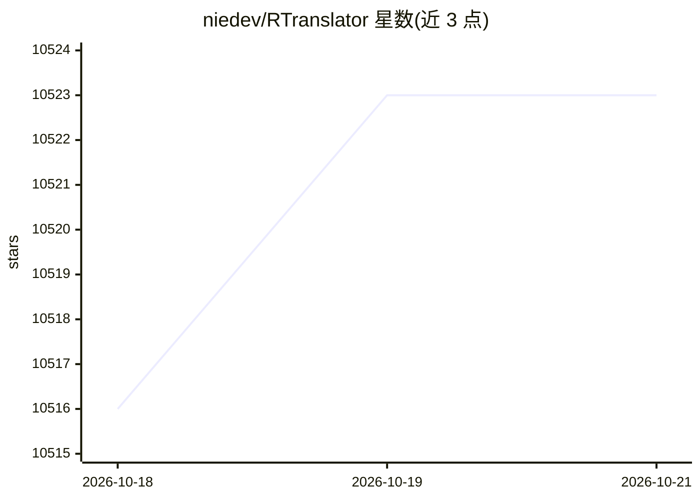

# niedev/RTranslator

⭐ 10,523 · Java · Apache-2.0 · 推送 2026-10-19 · [GitHub](https://github.com/niedev/RTranslator) · 个人维护

**Android 离线实时翻译应用，本地运行语音识别与翻译模型**

面向 Android 用户的免费实时翻译应用，支持三种模式：Conversation（多机蓝牙连接双向同传）、WalkieTalkie（单机双语轮流对话翻译）和文本翻译。语音识别使用 Whisper-Small-244M、翻译使用 NLLB-Distilled-600M，均转为 onnx 格式并部分 int8 量化，配合 OnnxRuntime 在手机本地运行，可离线使用且不收集个人数据。首次启动需下载约 1.2GB 模型，要求手机至少 6GB RAM。3.0 测试版将提供 Bergamot/Madlad/HY-MT 多翻译模型选择并完全开源。

## 筛选速览

| 维度 | 判定 | 备注 |
|---|---|---|
| AI 角色 | `ai-native` | 本体是模型或模型工具 |
| 许可风险 | `permissive` | Apache-2.0 |
| 部署形态 | `None` |  |
| 模型依赖 | — | README 未给出锁定关系 |
| 硬件要求 | — | 无带数字的原话,不猜 |
| 安装摩擦 | `low` | 无编译、无系统依赖或容器化 |
| 成熟度 | `idea` | |

## 能力要点

- Conversation/WalkieTalkie/文本三种翻译模式，支持蓝牙耳机与后台运行
- Whisper 与 NLLB 模型转为 onnx 并部分 int8 量化，NLLB 运行内存从 2.5GB 降至 1.3GB
- 全离线运行，不收集个人数据（作者声明无服务器）
- 3.0 测试版提供 Mozilla Bergamot/Madlad 400 3B/HY-MT 1.5 1.8B 多模型选择

## 适用场景

- 出国旅行或跨语言日常对话的实时翻译
- 街头问路、购物等快速双语交流（单机 WalkieTalkie 模式）
- 无网络环境下翻译对话
- 普通文本翻译

## 场景标签

`语音识别` · 领域:感知与多模态

## 证据(README 行号)

> L40: RTranslator uses Meta\'s NLLB for translation and OpenAi\'s Whisper for speech recognition, both are (almost) open-
> L15: - The audio captured will be converted into text and sent to the interlocutor's phone.

## 星数曲线

2026-10-18 10,516 → 2026-10-21 10,523（+7）

---
*卡片 v1 · prompt 1.4 · 生成 2026-10-20 · 置信度 high · 依据 README sha `bd44e42d142a` · [字段定义](../../DATASET.md)*
