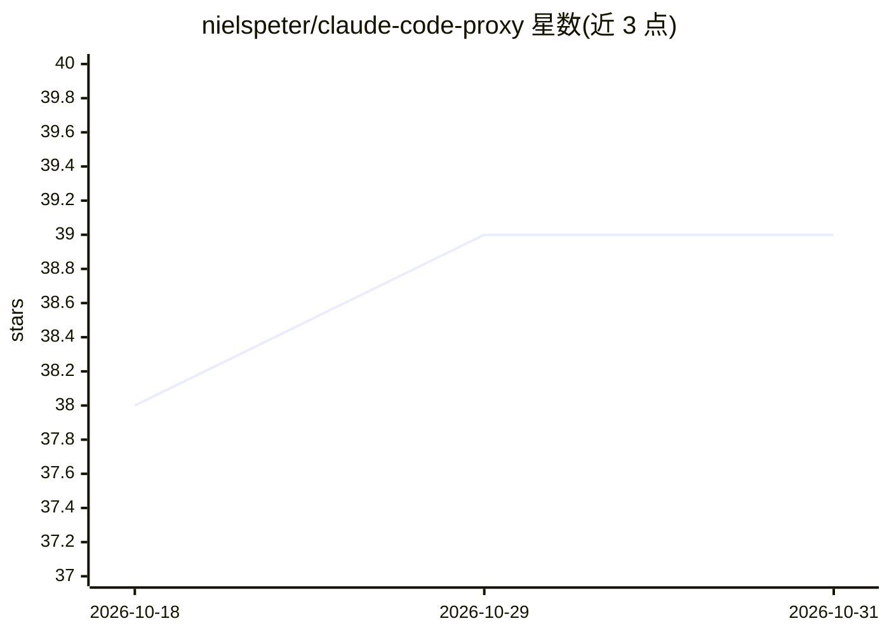

# nielspeter/claude-code-proxy

⭐ 39 · Go · MIT · 推送 2025-11-24 · [GitHub](https://github.com/nielspeter/claude-code-proxy) · 个人维护

**让 Claude Code 使用 OpenRouter/OpenAI/Ollama 的 HTTP 代理**

用 Go 编写的轻量 HTTP 代理：接收 Claude Code 发出的 Claude API 格式请求，转换为 OpenAI 格式后路由到 OpenRouter（200+ 模型）、OpenAI Direct（GPT-5）或 Ollama 本地推理，再把响应转回 Claude 格式，支持工具调用、扩展思考块、SSE 流式与 token 统计。提供基于模型的自适应参数探测（按 provider+model 缓存）、Claude 模型名到后端模型的路由映射、daemon 模式与 ccp 包装脚本。README 自声明为早期 Beta，生产环境使用需谨慎。

## 筛选速览

| 维度 | 判定 | 备注 |
|---|---|---|
| AI 角色 | `ai-ecosystem` | LLM/agent 周边工具 |
| 许可风险 | `permissive` | MIT |
| 部署形态 | `None` |  |
| 模型依赖 | local-ok | 支持本地模型 |
| 硬件要求 | — | 无带数字的原话,不猜 |
| 安装摩擦 | `medium` | 含编译或系统依赖之一 |
| 成熟度 | `idea` | |

## 能力要点

- Claude API ↔ OpenAI 格式双向转换，覆盖工具调用/thinking 块/流式
- 支持 OpenRouter、OpenAI Direct、Ollama 三类后端
- 自适应 per-model 参数探测并缓存，无需硬编码模型配置
- 单一约 10MB 二进制，零依赖，支持 daemon 模式

## 适用场景

- 不订阅 Anthropic API 而用 OpenRouter 或 GPT-5 运行 Claude Code
- 配合本地 Ollama 实现免费本地推理的 Claude Code
- 通过模型名路由映射切换后端模型

## 场景标签

`模型网关` · 领域:Agent 开发

## 证据(README 行号)

> L9: A lightweight HTTP proxy that enables Claude Code to work with OpenAI-compatible API providers including OpenRouter 
> L312:  - Proxy converts Claude format → OpenAI format
> L314:  - Provider returns OpenAI format response

## 星数曲线

2026-10-18 38 → 2026-10-31 39（+1）

---
*卡片 v1 · prompt 1.4 · 生成 2026-10-25 · 置信度 high · 依据 README sha `78133ecfa2dc` · [字段定义](../../DATASET.md)*
