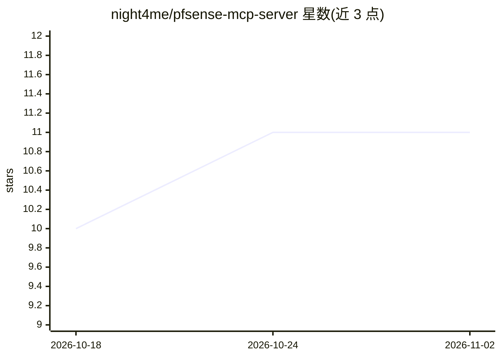

# night4me/pfsense-mcp-server

⭐ 11 · Python · MIT · 推送 2026-09-15 · [GitHub](https://github.com/night4me/pfsense-mcp-server) · [官网](https://night4me.github.io/pfsense-mcp-server/) · 个人维护

**给 AI 助手提供 pfSense 只读访问的 MCP 服务器**

面向 pfSense 防火墙的 MCP 服务器：向 AI 客户端（Claude Desktop、Codex、Cursor 等）提供 97 个强类型工具，覆盖系统、VPN、防火墙规则、DHCP、DNS、证书与诊断等约 90% 的 pfSense REST API READ 面；默认 0 个 WRITE 工具，唯一的受保护变更路径（防火墙别名描述编辑）需显式选择并经离机 Ed25519 签名授权与独立确认方可触达。以 pipx 从 PyPI 安装，需 Python 3.11–3.13 与启用 REST API 包的 pfSense。

## 筛选速览

| 维度 | 判定 | 备注 |
|---|---|---|
| AI 角色 | `ai-ecosystem` | LLM/agent 周边工具 |
| 许可风险 | `permissive` | MIT |
| 部署形态 | `library` | 以包/库形式分发 |
| 模型依赖 | — | README 未给出锁定关系 |
| 硬件要求 | — | 无带数字的原话,不猜 |
| 安装摩擦 | `low` | 无编译、无系统依赖或容器化 |
| 成熟度 | — | 结构信号不足 |

## 能力要点

- 97 个强类型（Pydantic）只读工具覆盖 pfSense 约 90% REST READ 面
- 默认 0 WRITE 工具；受保护变更需离机签名授权与独立确认的多重门控
- setup 向导可生成各 MCP 客户端的配置块
- README 工具需通过 make validate 构建期校验

## 适用场景

- 让 Claude/Cursor 等 AI 客户端查询防火墙状态、VLAN、证书到期等只读信息
- 在不给 LLM shell 权限的前提下做 pfSense 诊断问答
- 高级用户经显式授权让 AI 修改防火墙别名描述

## 场景标签

`网络安全` · 领域:学习与行业

## 证据(README 行号)

> L12: **Safe, least-privilege pfSense access for AI assistants.** MCP
> L13: server that gives an AI assistant strongly typed, read-only visibility into
> L87: AI client (Claude, Codex, ...)

## 星数曲线

2026-10-18 10 → 2026-11-02 11（+1）

---
*卡片 v1 · prompt 1.4 · 生成 2026-11-01 · 置信度 high · 依据 README sha `0a64081752a7` · [字段定义](../../DATASET.md)*
