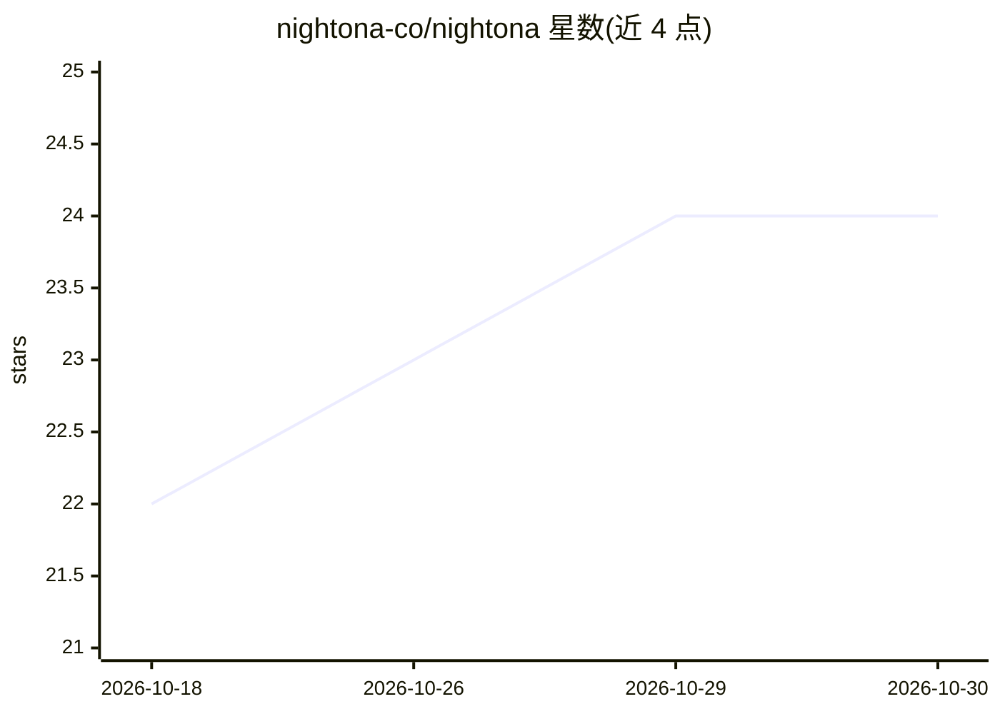

# nightona-co/nightona

⭐ 24 · TypeScript · AGPL-3.0 · 推送 2026-09-28 · [GitHub](https://github.com/nightona-co/nightona) · 组织维护

**自托管 AI 代码执行沙箱平台（Daytona 开源分支）**

Daytona v0.190.0 的社区开源分支：在自有基础设施上运行安全的弹性沙箱，供 AI 生成的代码执行与 agent 工作流使用。沙箱具备独立内核、文件系统、网络栈与分配的 CPU/RAM/磁盘，宣称 90ms 内启动，支持 Python/TypeScript/JavaScript，基于 OCI/Docker 兼容构建。提供 Python/TypeScript/Ruby/Go/Java SDK、REST API、CLI 与 dashboard；Docker Compose 与 Helm 部署。当前处 bootstrap 阶段：品牌重命名未完成，自有包与容器镜像尚未发布，SDK 需从源码构建。

## 筛选速览

| 维度 | 判定 | 备注 |
|---|---|---|
| AI 角色 | `ai-ecosystem` | LLM/agent 周边工具 |
| 许可风险 | `viral` | AGPL-3.0 |
| 部署形态 | `self-host` | docker 或自建部署 |
| 模型依赖 | — | README 未给出锁定关系 |
| 硬件要求 | — | 无带数字的原话,不猜 |
| 安装摩擦 | `low` | 无编译、无系统依赖或容器化 |
| 成熟度 | `idea` | |

## 能力要点

- 沙箱提供独立内核/文件系统/网络栈的完全隔离环境，支持快照与并行
- SDK 覆盖 Python/TypeScript/Ruby/Go/Java，另有 REST API 与 CLI
- Docker Compose 与 Helm 支持完全自托管部署
- 继承 Daytona 全部 git 历史（2,700+ commits），AGPL-3.0 许可

## 适用场景

- 为 AI agent 工作流提供隔离的代码执行沙箱
- 替代已闭源的 Daytona，延续现有开源部署
- 在自有基础设施上自托管完整沙箱平台

## 场景标签

 · 领域:AI 基础设施/沙箱运行时

## 证据(README 行号)

> L3: **Nightona is a community-maintained, open-source fork of Daytona: secure, elastic sandbox infrastructure for runnin
> L26: Nightona is a secure and elastic infrastructure runtime for AI-generated code execution and agent workflows. It pro
> L30: Agents and developers interact with sandboxes programmatically through SDKs (Python, TypeScript, Ruby, Go, Java), a

## 星数曲线

2026-10-18 22 → 2026-10-30 24（+2）

---
*卡片 v1 · prompt 1.4 · 生成 2026-10-27 · 置信度 high · 依据 README sha `8ed21492b1c7` · [字段定义](../../DATASET.md)*
