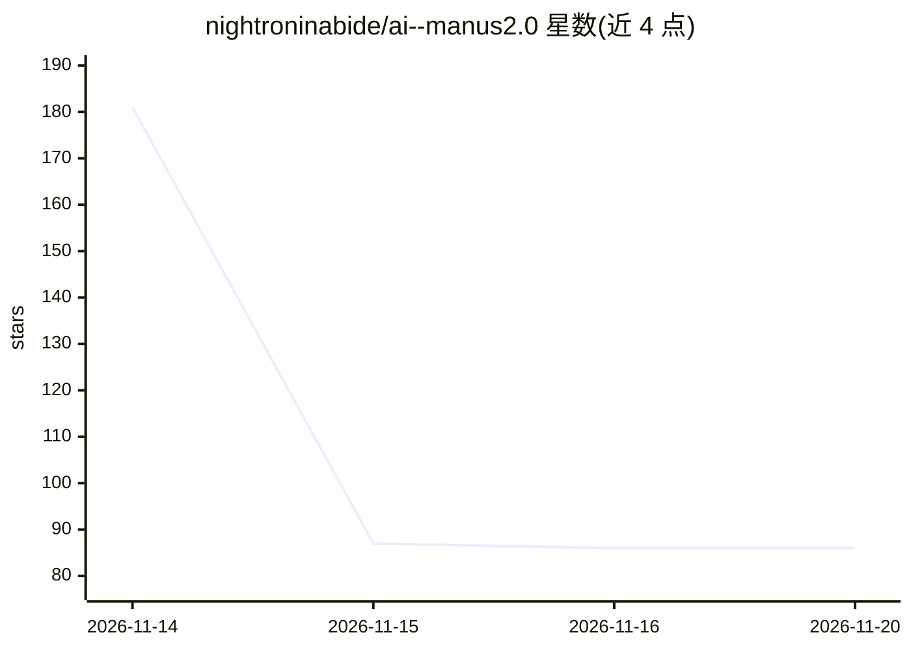

# nightroninabide/ai--manus2.0

⭐ 86 · Apache-2.0 · 推送 2026-11-15 · [GitHub](https://github.com/nightroninabide/ai--manus2.0) · 个人维护

**面向个人用户的自主 AI Agent：代写代码、控浏览器完成日常任务**

README 描述的 Manus 是一款自主 AI agent，代替用户执行代码编写与运行、浏览器导航/填表/采集信息，并串联多步任务，定位为家庭、学习与轻办公场景的个人助手，强调无需编程基础。机制层面仅说明沙箱中运行工具与后台常驻执行；限制：README 未给出安装命令、技术架构、模型接入方式或代码仓库结构，内容以功能宣传与搜索关键词为主，可验证的实现细节有限。

## 筛选速览

| 维度 | 判定 | 备注 |
|---|---|---|
| AI 角色 | `ai-native` | 本体是模型或模型工具 |
| 许可风险 | `permissive` | Apache-2.0 |
| 部署形态 | `None` |  |
| 模型依赖 | — | README 未给出锁定关系 |
| 硬件要求 | — | 无带数字的原话,不猜 |
| 安装摩擦 | `low` | 无编译、无系统依赖或容器化 |
| 成熟度 | — | 结构信号不足 |

## 能力要点

- 自主执行代码与控制浏览器完成多步任务
- 面向非开发者，覆盖学习、家庭与轻办公场景
- 后台常驻的个人助手形态，跨会话复用任务模式

## 适用场景

- 让学生整理研究笔记、跑小脚本与查资料
- 代替我在多个网页间采集信息并做小结
- 把重复性的小任务交给 agent 后台完成

## 场景标签

`AI 助手` `浏览器自动化` `编码 Agent` · 领域:效率与自动化

## 证据(README 行号)

> L10: - **Autonomous Code Execution:** Manus AI agent runs code on its own to complete tasks, so you can focus on decisio
> L18: Manus is an autonomous AI agent designed to run code and control a browser on your behalf. Instead of acting like a

## 星数曲线

2026-11-14 181 → 2026-11-20 86（-95）

---
*卡片 v1 · prompt 1.4 · 生成 2026-11-17 · 置信度 mid · 依据 README sha `637da4fbcded` · [字段定义](../../DATASET.md)*
