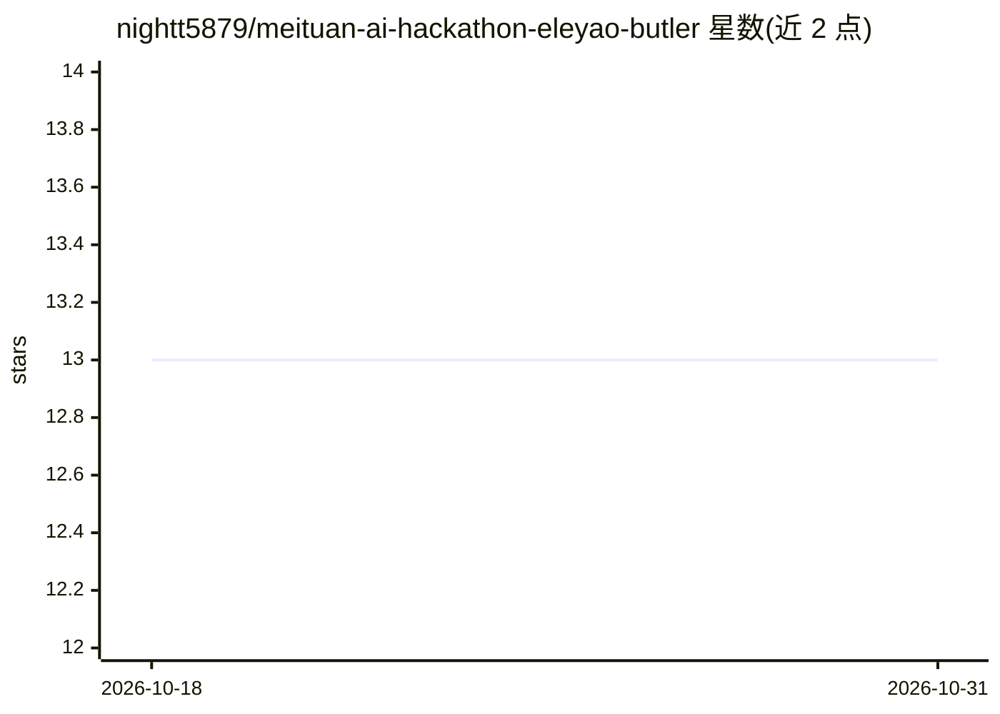

# nightt5879/meituan-ai-hackathon-eleyao-butler

⭐ 13 · TypeScript · MIT · 推送 2026-06-08 · [GitHub](https://github.com/nightt5879/meituan-ai-hackathon-eleyao-butler) · [官网](https://meituan-ai-hackathon.cn) · 组织维护 · 中文 README

**面向约饭与周末规划的本地生活 AI 管家（黑客松作品）**

2026 美团 AI 黑客松作品，基于 OpenClaw CLI/Gateway 构建的微信小程序 + Next.js 后端本地生活 Agent，覆盖单人吃饭推荐、多人约饭协同决策、周末路线规划三个场景。核心机制为「生成—自检—修正—执行」闭环：方案输出前经预算/时间/距离/口味/公平性/可执行性规则与 LLM-as-a-Judge 审计，不合格自动修正或追问；多人场景由成员标记约束权重并用公平性评分择优。所有模型调用在服务端进行，小程序不持有 token；远端不可用时降级到本地数据集兜底。

## 筛选速览

| 维度 | 判定 | 备注 |
|---|---|---|
| AI 角色 | `ai-native` | 本体是模型或模型工具 |
| 许可风险 | `permissive` | MIT |
| 部署形态 | `library` | 以包/库形式分发 |
| 模型依赖 | — | README 未给出锁定关系 |
| 硬件要求 | — | 无带数字的原话,不猜 |
| 安装摩擦 | `low` | 无编译、无系统依赖或容器化 |
| 成熟度 | — | 结构信号不足 |

## 能力要点

- 生成—自检—修正—执行闭环：规则 + LLM-as-a-Judge 审计方案约束
- 多人约饭：用户自定义「必须/希望满足」约束 + 公平性评分择优
- 三个核心策略打包为 OpenClaw Skill 交付件，可一键安装到 skills root
- 远端不可用时自动降级到本地 fallback 数据集 + 规则兜底

## 适用场景

- 一个人不知道吃什么时，通过问答收集偏好获得餐厅推荐
- 多人约饭时汇总冲突偏好，生成兼顾公平的方案并一键邀约
- 周末结合天气与 POI 数据生成带预算和风险提示的路线

## 场景标签

`推荐系统` `AI 助手` · 领域:对话与助手

## 证据(README 行号)

> L40: 微信小程序  ──HTTPS──▶  Next.js API Routes  ──server-side──▶  OpenClaw CLI / Gateway / LLM / 自建餐厅与 POI 数据集 / Open-Meteo
> L68:     A["用户 / 多人偏好输入 自然语言"] --> B["管家 Agent 理解任务 · 抽取硬约束/软偏好 · 调用工具"]
> L95: ### 1. 自检评测闭环（规则 + LLM-as-a-Judge）

## 星数曲线

2026-10-18 13 → 2026-10-31 13（+0）

---
*卡片 v1 · prompt 1.4 · 生成 2026-10-31 · 置信度 high · 依据 README sha `53d206ba6019` · [字段定义](../../DATASET.md)*
