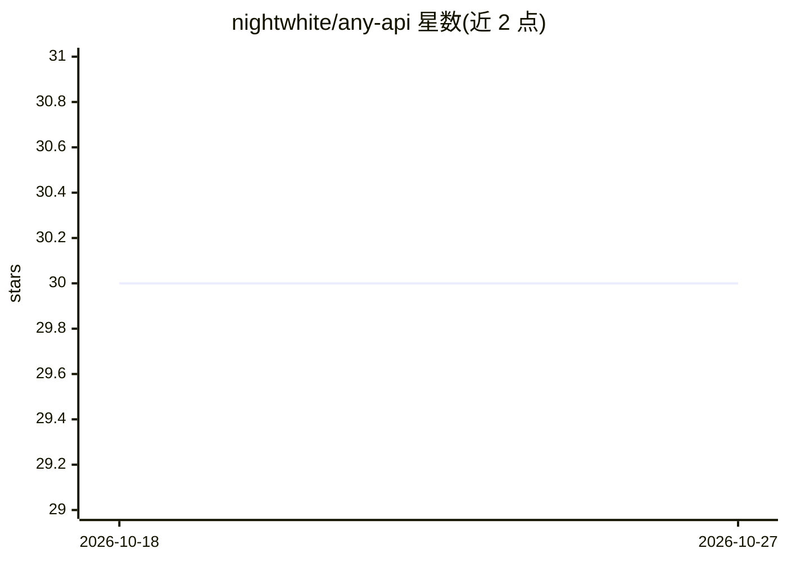

# nightwhite/any-api

⭐ 30 · TypeScript · MIT · 推送 2026-01-02 · [GitHub](https://github.com/nightwhite/any-api) · 个人维护 · 中文 README

**Cloudflare Worker 上的多协议 LLM API 互转与路由网关**

运行在 Cloudflare Workers 上的通用 LLM API 网关：同一套后端 provider 配置下，同时暴露 OpenAI Chat Completions、OpenAI Responses、Claude Messages、Gemini 四种前端协议入口，并在协议间互转路由。模型名统一为 provider.modelName 格式，网关据此定位上游 URL/key 与实际模型名。上游支持 openai-responses、openai-chat-completions、gemini、claude 四种 provider type；入站请求需携带 Worker 访问密钥。通过 npm 安装、wrangler 本地开发运行。

## 筛选速览

| 维度 | 判定 | 备注 |
|---|---|---|
| AI 角色 | `ai-ecosystem` | LLM/agent 周边工具 |
| 许可风险 | `permissive` | MIT |
| 部署形态 | `library` | 以包/库形式分发 |
| 模型依赖 | locked-api |  |
| 硬件要求 | — | 无带数字的原话,不猜 |
| 安装摩擦 | `low` | 无编译、无系统依赖或容器化 |
| 成熟度 | — | 结构信号不足 |

## 能力要点

- 四种前端协议入口：OpenAI Chat/Responses、Claude Messages、Gemini
- provider.modelName 统一命名定位上游连接与实际模型
- 支持四种上游 provider type 且可多 provider 并存
- 多方式入站鉴权（Bearer / x-api-key / x-goog-api-key / ?key=）

## 适用场景

- 用统一网关接入并互转多家 LLM API 协议
- 客户端以任意协议格式调用不同上游模型
- 在 Cloudflare Workers 上自建轻量 API 路由层

## 场景标签

`模型网关` · 领域:Agent 开发

## 证据(README 行号)

> L1: # Any API Gateway (Cloudflare Worker)
> L3: 在 Cloudflare Workers 上运行的通用 LLM API 互转/路由网关：同一套后端 provider 配置，同时暴露四种“前端协议”入口。

## 星数曲线

2026-10-18 30 → 2026-10-27 30（+0）

---
*卡片 v1 · prompt 1.4 · 生成 2026-10-26 · 置信度 high · 依据 README sha `eea7c80a5778` · [字段定义](../../DATASET.md)*
