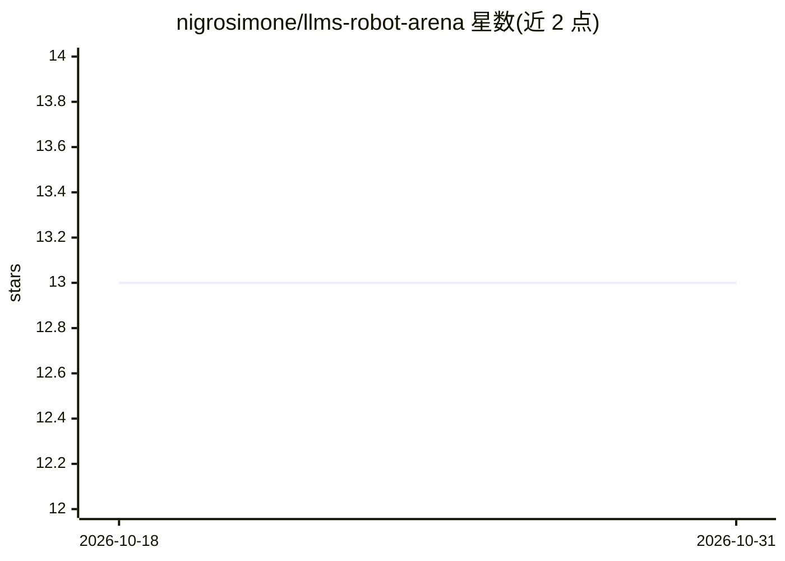

# nigrosimone/llms-robot-arena

⭐ 13 · JavaScript · 推送 2026-09-23 · [GitHub](https://github.com/nigrosimone/llms-robot-arena) · [官网](https://llms-robot-arena.sndesign.it/) · 个人维护

**让 LLM 编写机器人控制器并相互竞技的评测竞技场**

浏览器端运行的机器人格斗模拟竞技场：编码代理按 AGENTS.md 规则编写 JavaScript 控制器，相同机器人本体在含洞、火焰、能量补给与塌陷地板的平台上对抗。提供 3D 回放、手动操控、循环赛与排行导出；已发布 14 个控制器（OpenAI/Anthropic/DeepSeek/Z.ai 模型生成）的 1820 场展览赛成绩。线上版无需安装或 API key；本地需 Node.js 24+，通过 npm ci/start 运行；也可经 MCP 让自己的 LLM 参战。比赛期间不做任何 LLM 调用。

## 筛选速览

| 维度 | 判定 | 备注 |
|---|---|---|
| AI 角色 | `ai-ecosystem` | LLM/agent 周边工具 |
| 许可风险 | `none` | — |
| 部署形态 | `None` |  |
| 模型依赖 | — | README 未给出锁定关系 |
| 硬件要求 | — | 无带数字的原话,不猜 |
| 安装摩擦 | `low` | 无编译、无系统依赖或容器化 |
| 成熟度 | — | 结构信号不足 |

## 能力要点

- 浏览器内模拟，无需安装、账号或 API key 即可试用
- 经 MCP 连接自有 LLM 编写控制器并提交参赛
- 发布 1820 场循环赛成绩、风格画像与源码复杂度统计
- 回放可暂停、变速、以 JSON 导入导出，种子保证布局可复现

## 适用场景

- 测试不同编码代理把共享规格转化为可用控制器的能力
- 在本地或浏览器举办自己的机器人控制器锦标赛
- 手写控制器并与 AI 生成的 bot 对战

## 场景标签

`模型评测` · 领域:评测与运维

## 证据(README 行号)

> L3: An arena where **LLMs write robot controllers and their code competes**.
> L52: An LLM writes the controller before the match. During the match, that JavaScript program receives the robot's senso
> L54: This makes the project a way to explore how well coding agents turn a shared specification into working strategies.
> L7: > It's not an AGI benchmark. It tests how coding agents turn the same dynamic specification into an autonomous contr

## 星数曲线

2026-10-18 13 → 2026-10-31 13（+0）

---
*卡片 v1 · prompt 1.4 · 生成 2026-10-31 · 置信度 high · 依据 README sha `7dc310f92481` · [字段定义](../../DATASET.md)*
