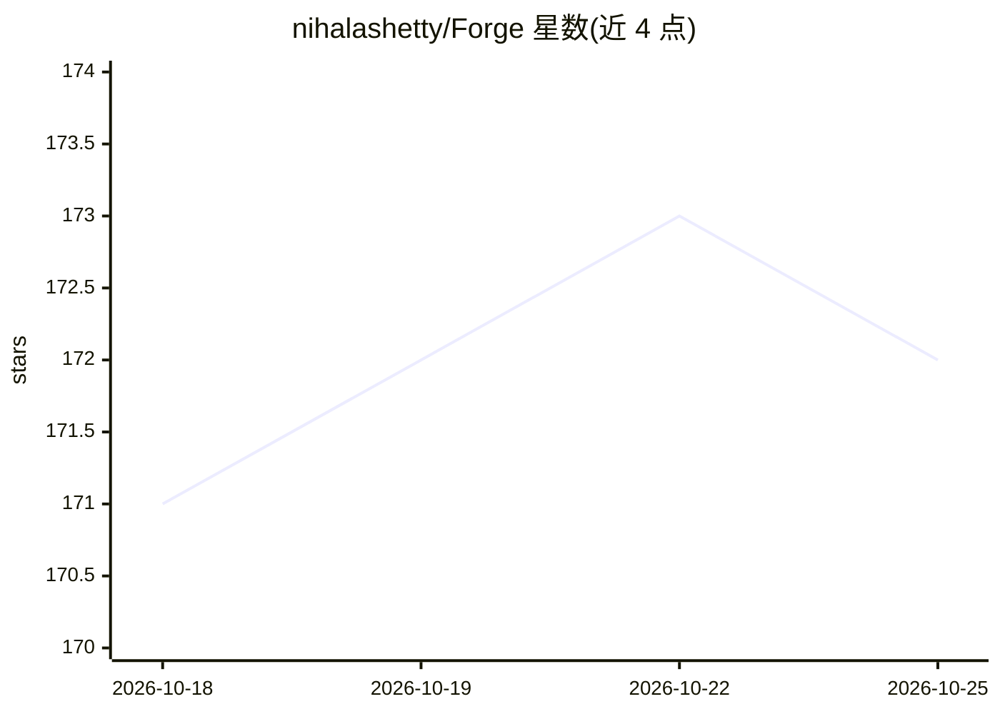

# nihalashetty/Forge

⭐ 172 · Python · MIT · 推送 2026-10-11 · [GitHub](https://github.com/nihalashetty/Forge) · 个人维护

**自托管的可视化 AI agent 与工作流构建平台**

基于 LangChain/LangGraph（MIT）构建的开源自托管平台：在拖拽画布上编排 agent、工具、知识与逻辑，支持 Deep Agent 与子 agent supervisor、RAG 知识库、生成式 UI 组件与可嵌入网页挂件；通过统一 run API、MCP 服务器、邮件等渠道部署。本地零依赖启动（SQLite + 内置 Chroma），生产可切换 Postgres/pgvector 与 Redis。内置护栏、预算、RBAC、评测与追踪。需 Python 3.11–3.13 与 Node 22 从源码运行；预置连接器市场尚未实现。

## 筛选速览

| 维度 | 判定 | 备注 |
|---|---|---|
| AI 角色 | `ai-ecosystem` | LLM/agent 周边工具 |
| 许可风险 | `permissive` | MIT |
| 部署形态 | `self-host` | docker 或自建部署 |
| 模型依赖 | — | README 未给出锁定关系 |
| 硬件要求 | — | 无带数字的原话,不猜 |
| 安装摩擦 | `low` | 无编译、无系统依赖或容器化 |
| 成熟度 | `idea` | |

## 能力要点

- 拖拽画布编排 agent、工具、检索与人审节点，类型化校验
- RAG 知识库（分块/嵌入/向量存储/搜索调试器），默认可离线嵌入
- 同一工作流经 run API、MCP 服务器（双向 MCP）、邮件或网页挂件部署
- 护栏/PII 脱敏、预算配额、RBAC、评测与 span 级追踪

## 适用场景

- 在自己的基础设施上可视化搭建并部署 AI agent 工作流
- 把 agent 接入自有系统并通过 MCP/API/网页挂件交付
- 对 agent 运行做成本、追踪与评测管理

## 场景标签

`Agent 框架` `工作流自动化` · 领域:Agent 开发

## 证据(README 行号)

> L3: **The open-source, self-hosted platform for visually building, testing, and shipping AI agents & workflows.**
> L17: Forge is built directly on the **MIT-licensed LangChain + LangGraph** framework - and **never** depends on `langgra

## 星数曲线

2026-10-18 171 → 2026-10-25 172（+1）

---
*卡片 v1 · prompt 1.4 · 生成 2026-10-22 · 置信度 mid · 依据 README sha `514066cb300d` · [字段定义](../../DATASET.md)*
