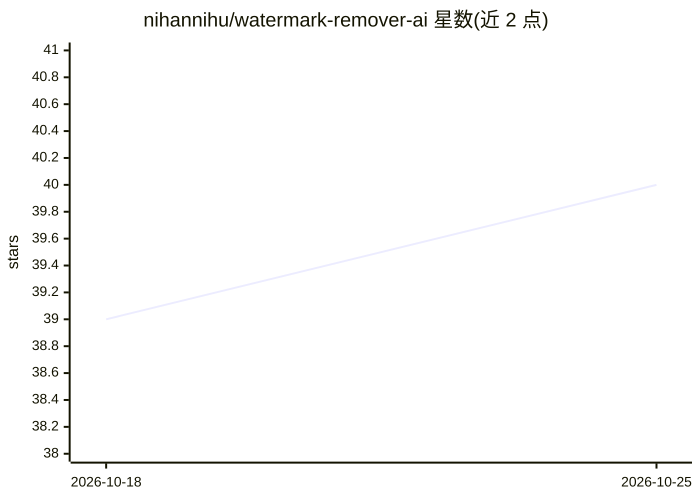

# nihannihu/watermark-remover-ai

⭐ 40 · Python · MIT · 推送 2026-10-04 · [GitHub](https://github.com/nihannihu/watermark-remover-ai) · 个人维护 · 中文 README

**离线去除图片/视频水印与标识的 AI 桌面工具**

免费离线的视频与图片水印去除应用：用 Microsoft Florence-2 视觉模型检测水印位置，用 LaMA 模型做图像修复填充去除区域。支持单文件与批量处理、预览模式、淡入淡出水印的掩码扩展、CUDA 加速，模型在首次运行时自动下载。提供 PyWebview 图形界面与命令行两种使用方式；处理视频时需另装 FFmpeg 才能保留音频。Windows 提供便携式 Python 环境的 setup 脚本，Linux/macOS 需系统 Python 3.10-3.12。

## 筛选速览

| 维度 | 判定 | 备注 |
|---|---|---|
| AI 角色 | `ai-native` | 本体是模型或模型工具 |
| 许可风险 | `permissive` | MIT |
| 部署形态 | `None` |  |
| 模型依赖 | — | README 未给出锁定关系 |
| 硬件要求 | — | 无带数字的原话,不猜 |
| 安装摩擦 | `medium` | 含编译或系统依赖之一 |
| 成熟度 | — | 结构信号不足 |

## 能力要点

- Florence-2 检测水印 + LaMA 图像修复的离线两段式去除流程
- 支持单文件与整文件夹批量处理，含预览检测模式
- 支持 MP4/AVI/MOV/MKV 等 7 种视频格式与音频保留（需 FFmpeg）
- 提供 GUI 与 CLI 两种模式，CLI 含透明化、检测跳帧、淡入淡出掩码扩展等参数

## 适用场景

- 去除 AI 生成视频（如 Sora、Runway 产物）上的水印或标识
- 批量清理整个文件夹图片中的水印与文字
- 仅需预览水印检测位置而不做处理

## 场景标签

`图像视频处理` · 领域:感知与多模态

## 证据(README 行号)

> L11: `WatermarkRemover-AI` is a 100% free, unlimited, and offline application that leverages AI models for precise water
> L13: It uses Florence-2 from Microsoft for watermark identification and LaMA for inpainting to fill in the removed regio

## 星数曲线

2026-10-18 39 → 2026-10-25 40（+1）

---
*卡片 v1 · prompt 1.4 · 生成 2026-10-25 · 置信度 high · 依据 README sha `1f9f9c81e5d6` · [字段定义](../../DATASET.md)*
