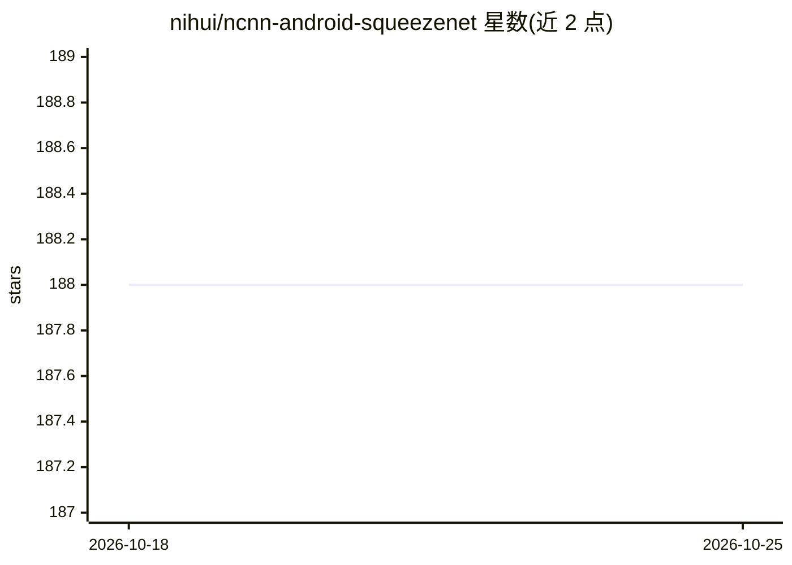

# nihui/ncnn-android-squeezenet

⭐ 188 · C++ · 推送 2026-10-23 · [GitHub](https://github.com/nihui/ncnn-android-squeezenet) · 个人维护

**基于 ncnn 的 SqueezeNet 图像分类 Android 示例应用**

nihui 维护的 Android 示例工程：在移动端运行 SqueezeNet 模型做图像分类，仅依赖 ncnn 库（支持 Vulkan GPU 加速）。提供预编译 apk 的 Releases 下载；源码构建需先下载 ncnn android-vulkan 预编译包解压到 jni 目录并修改 CMakeLists 中的 ncnn_DIR 路径，再用 Android Studio 打开构建。属于官方 ncnn 生态的示例项目，面向想在 Android 上部署神经网络推理的开发者。

## 筛选速览

| 维度 | 判定 | 备注 |
|---|---|---|
| AI 角色 | `ai-native` | 本体是模型或模型工具 |
| 许可风险 | `none` | — |
| 部署形态 | `desktop` | 安装包/桌面程序 |
| 模型依赖 | — | README 未给出锁定关系 |
| 硬件要求 | — | 无带数字的原话,不猜 |
| 安装摩擦 | `low` | 无编译、无系统依赖或容器化 |
| 成熟度 | — | 结构信号不足 |

## 能力要点

- SqueezeNet 图像分类的完整 Android 示例工程
- 仅依赖 ncnn 库，支持 Vulkan GPU 加速版本
- 提供预编译 apk 与源码构建两条路径

## 适用场景

- 学习在 Android 项目中集成 ncnn 推理库
- 验证 SqueezeNet 模型在移动端 CPU/GPU 上的运行效果
- 作为其他 ncnn Android 应用的工程模板

## 场景标签

`目标检测` · 领域:感知与多模态

## 证据(README 行号)

> L3: The squeezenet image classification
> L5: this is a sample ncnn android project, it depends on ncnn library only

## 星数曲线

2026-10-18 188 → 2026-10-25 188（+0）

---
*卡片 v1 · prompt 1.4 · 生成 2026-10-22 · 置信度 high · 依据 README sha `04ffbda74baf` · [字段定义](../../DATASET.md)*
