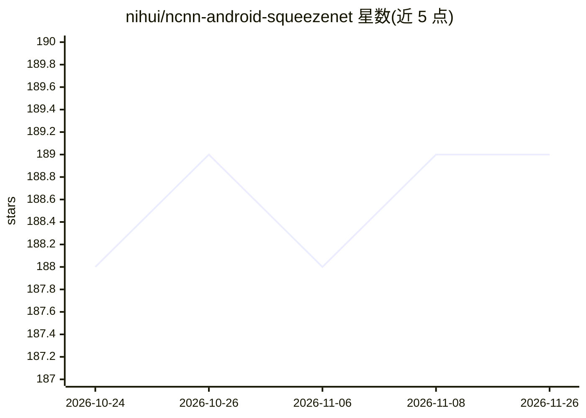

# nihui/ncnn-android-squeezenet

⭐ 189 · C++ · 推送 2026-10-27 · [GitHub](https://github.com/nihui/ncnn-android-squeezenet) · 个人维护

**基于 ncnn 的 Android 端 SqueezeNet 图像分类示例项目**

ncnn 库官方示例工程：在 Android 上运行 SqueezeNet 卷积神经网络，对输入图像做图像分类推理，支持 CPU 与 GPU（Vulkan，可选 OpenCL 驱动）两种推理路径。项目仅依赖 ncnn 库，README 给出四步构建流程——下载预编译 ncnn Android 包并配置 CMake、可选下载 mesa turnip GPU 驱动、可选下载 momoten 驱动、用 Android Studio 打开构建。提供最新 release 的 APK 直接下载，运行要求 Android 5.0（API 21）及以上；驱动无法加载时 CPU 推理仍可用。

## 筛选速览

| 维度 | 判定 | 备注 |
|---|---|---|
| AI 角色 | `ai-native` | 本体是模型或模型工具 |
| 许可风险 | `none` | — |
| 部署形态 | `desktop` | 安装包/桌面程序 |
| 模型依赖 | — | README 未给出锁定关系 |
| 硬件要求 | — | 无带数字的原话,不猜 |
| 安装摩擦 | `low` | 无编译、无系统依赖或容器化 |
| 成熟度 | — | 结构信号不足 |

## 能力要点

- Android 端 SqueezeNet 图像分类推理示例
- 支持 CPU 与 Vulkan GPU 推理，可选 OpenCL 驱动
- 提供预构建 APK 直接下载
- 仅依赖 ncnn 库，四步完成构建

## 适用场景

- 学习如何在 Android 上用 ncnn 部署图像分类模型
- 测试手机端 CPU/GPU 神经网络推理
- 作为 ncnn Android 工程集成模板参考

## 场景标签

`目标检测` `教程课程` · 领域:学习与行业

## 证据(README 行号)

> L3: The squeezenet image classification
> L5: this is a sample ncnn android project, it depends on ncnn library only
> L43: * Select the GPU driver, then use the GPU button; CPU inference remains available when a driver cannot load

## 星数曲线

2026-10-24 188 → 2026-11-26 189（+1）

---
*卡片 v1 · prompt 1.4 · 生成 2026-11-26 · 置信度 high · 依据 README sha `7e0fa60f5355` · [字段定义](../../DATASET.md)*
