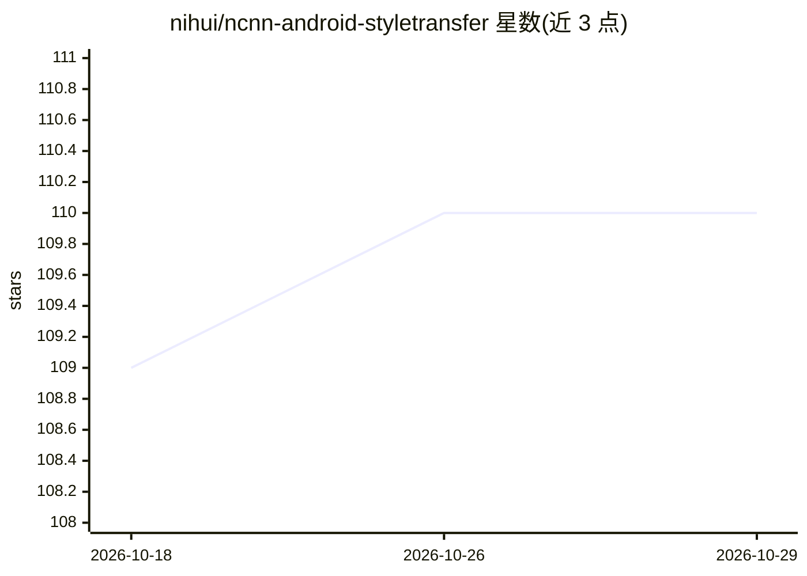

# nihui/ncnn-android-styletransfer

⭐ 110 · C · 推送 2026-10-27 · [GitHub](https://github.com/nihui/ncnn-android-styletransfer) · 个人维护

**在 Android 上运行风格迁移的 ncnn 示例应用**

基于 ncnn 库的 Android 风格迁移示例工程，仅依赖 ncnn。提供 APK 下载；也可用 Android Studio 自行构建：需下载 ncnn android-vulkan 预编译包，可选集成 mesa turnip 或 momoten GPU 驱动以启用 GPU（Vulkan/OpenCL）推理，驱动加载失败时回退 CPU 推理。要求 Android 5.0（API 21）及以上，Turnip 驱动仅支持 arm64-v8a。

## 筛选速览

| 维度 | 判定 | 备注 |
|---|---|---|
| AI 角色 | `ai-native` | 本体是模型或模型工具 |
| 许可风险 | `none` | — |
| 部署形态 | `desktop` | 安装包/桌面程序 |
| 模型依赖 | — | README 未给出锁定关系 |
| 硬件要求 | — | 无带数字的原话,不猜 |
| 安装摩擦 | `low` | 无编译、无系统依赖或容器化 |
| 成熟度 | — | 结构信号不足 |

## 能力要点

- 仅依赖 ncnn 库的 Android 风格迁移示例
- 支持 Vulkan GPU 推理，驱动不可用时回退 CPU 推理
- 提供预编译 APK 与 Android Studio 构建两种途径
- 可选集成 mesa turnip / momoten GPU 驱动

## 适用场景

- 在手机上体验神经风格迁移效果
- 学习 ncnn 在 Android 上的 GPU/CPU 推理集成方式
- 验证 turnip/momoten 驱动在自有设备上的可用性

## 场景标签

`图像视频处理` `教程课程` · 领域:学习与行业

## 证据(README 行号)

> L1: # ncnn-android-styletransfer
> L3: The style transfer android example
> L5: this is a sample ncnn android project, it depends on ncnn library only

## 星数曲线

2026-10-18 109 → 2026-10-29 110（+1）

---
*卡片 v1 · prompt 1.4 · 生成 2026-10-23 · 置信度 high · 依据 README sha `5159b491ced1` · [字段定义](../../DATASET.md)*
