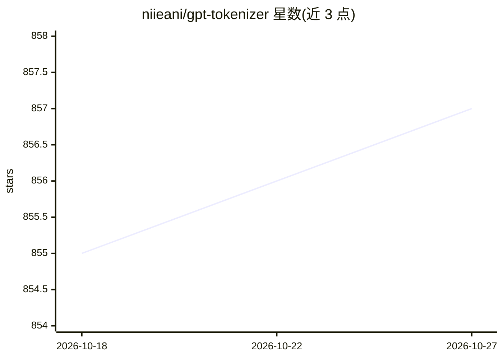

# niieani/gpt-tokenizer

⭐ 857 · TypeScript · MIT · 推送 2026-10-18 · [GitHub](https://github.com/niieani/gpt-tokenizer) · [官网](https://gpt-tokenizer.dev) · 个人维护

**TypeScript 实现的 OpenAI GPT 模型 BPE 分词器库**

gpt-tokenizer 是用 TypeScript 编写的字节对编码（BPE）分词/解码库，为 OpenAI 全部模型家族提供文本与 token 序列的相互转换，是 OpenAI tiktoken 的移植并附加功能。面向 JavaScript/TypeScript 开发者，支持同步加载、生成器版本编解码、异步流解码、isWithinTokenLimit 快速限额检查、estimateCost 成本估算，并内置含上下文限制与定价的 OpenAI 模型目录。可直接在浏览器中运行，另提供在线 playground。限制：仅覆盖 OpenAI 编码体系，UMD 全局包不再发布。

## 筛选速览

| 维度 | 判定 | 备注 |
|---|---|---|
| AI 角色 | `ai-ecosystem` | LLM/agent 周边工具 |
| 许可风险 | `permissive` | MIT |
| 部署形态 | `library` | 以包/库形式分发 |
| 模型依赖 | — | README 未给出锁定关系 |
| 硬件要求 | — | 无带数字的原话,不猜 |
| 安装摩擦 | `low` | 无编译、无系统依赖或容器化 |
| 成熟度 | — | 结构信号不足 |

## 能力要点

- 支持全部 OpenAI 模型家族与全部编码（o200k_base/cl100k_base 等）
- encodeChat 直接对聊天消息分词，countChatCompletionTokens 计算函数调用开销
- isWithinTokenLimit 无需完整编码即可检查 token 限额
- estimateCost 基于模型定价估算 API 成本

## 适用场景

- 在前端或 Node 中本地计算 prompt 的 token 数与成本
- 流式输出场景中分块解码 token 序列
- 按模型目录查询上下文限制、能力与定价

## 场景标签

 · 领域:LLM 基础设施/文本处理

## 证据(README 行号)

> L8: `gpt-tokenizer` is a TypeScript Byte Pair Encoder/Decoder for every OpenAI model family, including GPT-5, GPT-4.1, G
> L68: The library provides various functions to transform text into (and from) a sequence of integers (tokens) that can b

## 星数曲线

2026-10-18 855 → 2026-10-27 857（+2）

---
*卡片 v1 · prompt 1.4 · 生成 2026-10-21 · 置信度 high · 依据 README sha `6a8db5292c50` · [字段定义](../../DATASET.md)*
