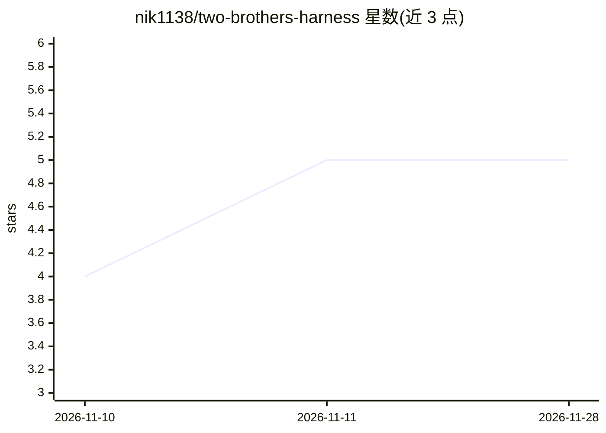

# nik1138/two-brothers-harness

⭐ 5 · TypeScript · MIT · 推送 2026-11-26 · [GitHub](https://github.com/nik1138/two-brothers-harness) · 个人维护

**双 AI 角色协作的 CLI harness：senior 与 junior 共享上下文做决策**

TypeScript 编写的 CLI harness，编排两个 AI agent 的协作：senior（仲裁者）与 junior（挑战者）共享一个上下文，使用结构化协议消息执行 consult→proposal→review→decision 循环，二者为对等关系而非子代理层级。提供 CLI run/chat/tui、Vue 3 web 工作区与 HTTP 后端三种工作区。内置离线 mock provider 免 API key 可运行，通过环境变量或 onboard 命令接入真实模型。需 Node ≥ 22.19，MIT 许可，当前版本 0.0.2。

## 筛选速览

| 维度 | 判定 | 备注 |
|---|---|---|
| AI 角色 | `ai-ecosystem` | LLM/agent 周边工具 |
| 许可风险 | `permissive` | MIT |
| 部署形态 | `library` | 以包/库形式分发 |
| 模型依赖 | local-ok | 支持本地模型 |
| 硬件要求 | — | 无带数字的原话,不猜 |
| 安装摩擦 | `low` | 无编译、无系统依赖或容器化 |
| 成熟度 | — | 结构信号不足 |

## 能力要点

- 双角色协作核心：consult/work/auto 三种模式，分歧记录进最终决策
- 结构化协议：envelope 信封与 consult/proposal/review/decision 消息类型，附 JSON Schema
- OpenAI-compatible/Anthropic/Gemini 适配器，带顺序重试注册表与成本估算
- 工作区工具带操作员审批：写操作挂起待批准，四档权限预设

## 适用场景

- 让两个模型角色互相质询后给出经过审查的任务决策
- 离线 mock 模式下演示或测试 agent 协作流程
- 通过 MCP、插件与 SKILL.md 技能扩展 agent 能力

## 场景标签

`多智能体` `Agent 框架` · 领域:Agent 开发

## 证据(README 行号)

> L7: Two Brothers is a harness for cooperation between two agents: a **senior** (the
> L74: - **Providers and presets** — OpenAI-compatible, Anthropic, and Gemini adapters with an ordered retry registry; `on
> L76: - **Three workspaces, one harness** — CLI `run` transcript, Vue 3 web workspace (`serve`), and a zero-dependency TU

## 星数曲线

2026-11-10 4 → 2026-11-28 5（+1）

---
*卡片 v1 · prompt 1.4 · 生成 2026-11-21 · 置信度 high · 依据 README sha `0a3bf077e61e` · [字段定义](../../DATASET.md)*
